# Adaptive Filters for Image Denoising

The LMS adaptive noise canceller in its six classic configurations, carried from one-dimensional signals to
images. Each configuration is implemented in **Python** and **MATLAB**, explained with its block diagram and
theory, and tested on a test image corrupted by eleven kinds of noise: Gaussian (white and correlated),
Poisson, blur, salt and pepper, random-valued impulses, bursts, telegraph noise (pixel and readout),
periodic interference and row banding. Each corruption is applied alone, and then all of them together.

<p align="center">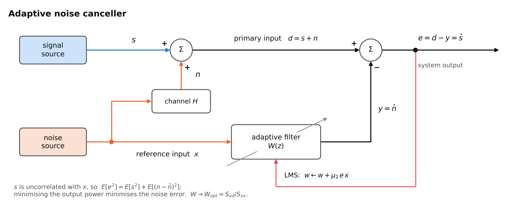</p>

The canceller has two inputs. The **primary** $d = s + n$ carries the image $s$ and the noise $n$. The
**reference** $x$ is correlated with $n$ but not with $s$. An adaptive filter turns $x$ into an estimate
$y = \hat n$, and the output is $e = d - y$. Because $s$ is uncorrelated with $x$,

$$E[e^2] = E[s^2] + E[(n - \hat n)^2],$$

so minimising the output power, which LMS does with $w \leftarrow w + \mu_2\, e\, x$, minimises the noise
error without ever seeing $s$. The six scenarios differ in **where the reference comes from** and **which
output is kept**. The theory is in [docs/0_principle.md](docs/0_principle.md).

## Visual implementation atlas

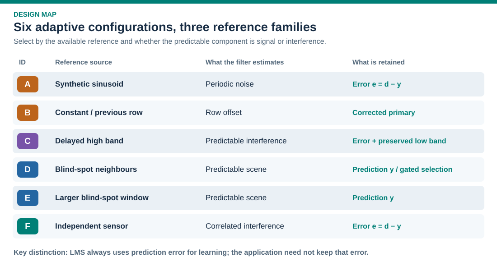

The unifying design choice is **what the adaptive filter predicts**. In A, B, C and F the prediction represents an unwanted component; D and E instead predict useful image structure. D gated selects between the original pixel and its prediction, using the error as a corruption detector. The [implementation atlas](docs/implementation_atlas.md) includes worked numerical examples, implementation-level block diagrams, synthetic image demonstrations and guidance on diagnosing failures.

[Adaptive-filter theory](docs/0_principle.md) · [Worked examples and visual atlas](docs/implementation_atlas.md) · [Noise models](docs/noise_models.md) · [Evaluation protocol](docs/evaluation_protocol.md) · [Full benchmark CSV](results/benchmark_python.csv)

## The six scenarios at a glance

| | Scenario | Reference | Output kept | Image form | Fits | Best result here |
|---|---|---|---|---|---|---|
| **A** | [Adaptive notch](docs/A_adaptive_notch.md) | synthetic $\cos/\sin$ at the interference frequency | error | 2-D plane-wave reference in raster order; frequencies known or detected | stripes, moire, flicker | **+20.1 dB** on periodic interference |
| **B** | [Bias / drift canceller](docs/B_bias_drift.md) | constant 1 | error | line-to-line bias weight, high-pass across rows | row offsets, drift | +7.3 dB on row banding |
| **C** | [Periodic interference without a reference](docs/C_periodic_noref.md) | delayed primary | error | delayed canceller on the high band of each row | periodic interference, frequency unknown | +6.6 dB on periodic interference |
| **D** | [Self-tuning filter](docs/D_self_tuning.md) | delayed primary | filter output | blind-spot predictor; error-gated variant for sparse noise | white noise; impulses, bursts (gated) | +5.9 dB Poisson, +12.6 dB impulses (gated) |
| **E** | [Adaptive line enhancer](docs/E_line_enhancer.md) | delayed primary, $L$ taps | filter output | larger window, blind spot sized to the noise correlation | periodic texture in noise, correlated noise | +11.3 dB on a noisy lattice |
| **F** | [Reference-sensor canceller](docs/F_reference_canceller.md) | a sensor that sees only the interference | error | optical-black columns, reference output channel | banding, readout telegraph | **+13.8 dB** banding, **+11.6 dB** telegraph |

All gains are PSNR improvements over the noisy input. The committed benchmark uses fixed default parameters; the clean image is used to generate corruptions and score results, not as an input to the denoisers. F receives simulated reference channels and independent dark calibration. Specialised theory and texture examples are separate from the camera-image benchmark.

## Which scenario fits which corruption

<p align="center">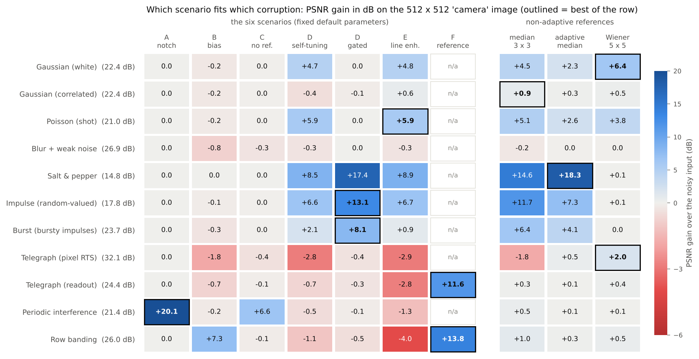</p>

The figure reads row by row. Each kind of interference is removed by the configuration whose reference matches
its structure:

* **Narrowband interference** has a deterministic reference. With a known or detected frequency, the notch (A)
  removes it almost completely; the result is limited by the image content inside the notch. Without one, the
  no-reference canceller (C) still gains 6.6 dB.
* **Interference with a physical reference** is cancelled by F close to the two-input theory: 39.76 dB measured
  against 39.90 dB predicted for banding, and 36.05 dB against 36.13 dB for readout telegraph noise.
  Without the reference, nothing else touches readout telegraph noise. For banding, B is the
  reference-free fallback.
* **Broadband noise** (white Gaussian, Poisson) suits the self-tuning filter D and the line enhancer E:
  +4.7 to +5.9 dB. They trail a local Wiener filter on white Gaussian noise (27.15 dB against 28.82 dB) and
  beat it on Poisson noise (26.83 dB against 24.76 dB).
* **Sparse noise** (impulses, bursts, salt and pepper) breaks plain LMS. Used as a detector, the error output
  turns D into the best filter here for random-valued impulses and bursts. The adaptive median keeps the edge
  on salt and pepper, because it exploits the fact that those pixels sit at exactly 0 or 1.
* **Blur** is a convolution, not additive interference, and none of the six removes it. The same LMS machinery
  wired as an inverse model does: see [docs/beyond_blur.md](docs/beyond_blur.md).

The [PSNR summary](results/benchmark_python.md) includes cascade SSIM. The [complete benchmark CSV](results/benchmark_python.csv) includes per-method PSNR, SSIM, gain and timing. See [evaluation protocol](docs/evaluation_protocol.md) for metric conventions and evidence boundaries.

## The scenarios

The new visual panels below show controlled, independently computed 96 × 64 illustrations of the core equations. Their settings and PSNR are stated in each panel. They complement, but do not replace, the original 512 × 512 benchmark figures or the original Python/MATLAB implementations. See the [synthetic scores](results/atlas_synthetic.csv) and [generator](tools/build_atlas.cjs).

### A. Adaptive notch filter
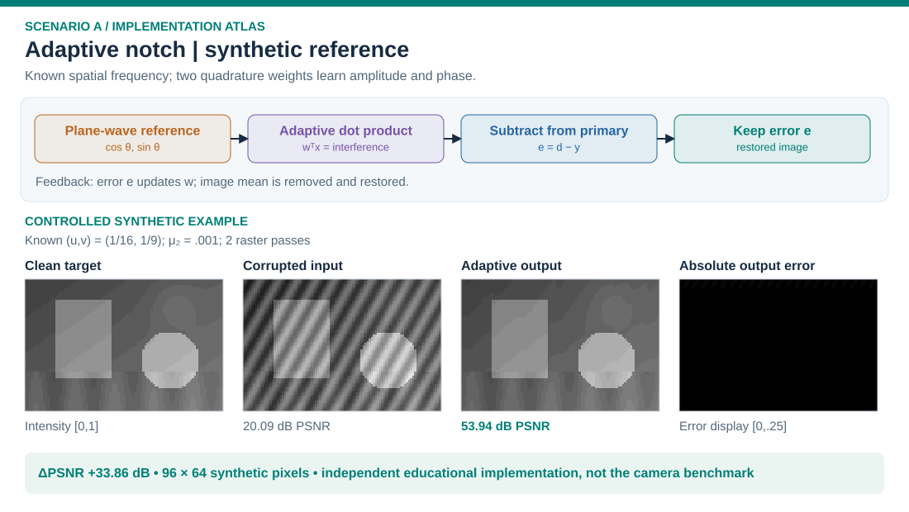

<details>
<summary>Classical adaptive-filter block diagram</summary>

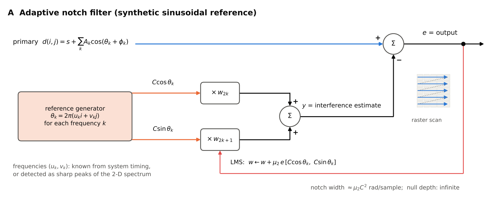

</details>

A pair of synthetic references, $C\cos\theta$ and $C\sin\theta$, lets two weights build any amplitude and
phase at the interference frequency. In an image, $\theta = 2\pi(u i + v j)$ is a plane wave scanned in raster
order. The weights learn amplitude and phase once and keep them from row to row. Frequencies are found as sharp
peaks of the averaged 2-D spectrum.

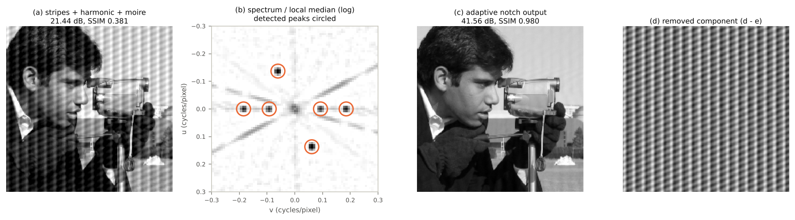

The notch has zeros on the unit circle and a width of about $\mu_2 C^2$ rad/sample. A narrower notch removes
less image, but it needs a more exact frequency:


### B. Bias (drift) canceller
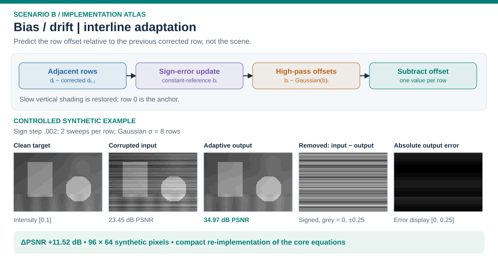

<details>
<summary>Classical adaptive-filter block diagram</summary>

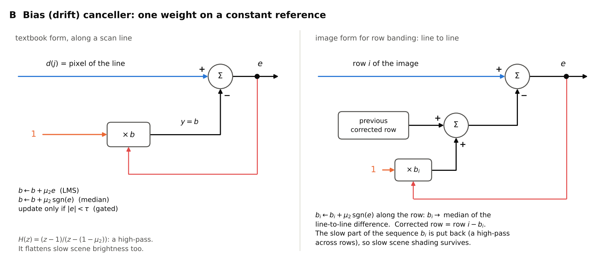

</details>

One weight on a constant reference is a first-order high-pass, $H(z) = (z-1)/(z-(1-\mu_2))$. Run along scan
lines, it cannot tell drift from scene brightness, so it works only on flat backgrounds such as probe
microscopy and documents, and only once the update is gated to background pixels. For row banding on natural
images, the bias weight runs line to line, and a high-pass across rows protects slow shading.


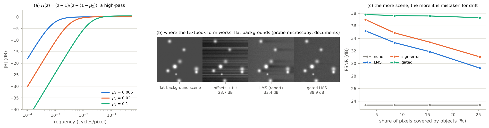

### C. Periodic interference without a reference


<details>
<summary>Classical adaptive-filter block diagram</summary>


</details>

The delayed primary serves as the reference. The broadband part decorrelates within the delay and the
periodic part does not, so the error output keeps the broadband part. On raw image rows the image itself is
predictable and gets cancelled too, giving 15.96 dB from 21.44 dB. Run on the high band of each row, where the
scene is less predictable in this example, the canceller finds the interference lines by itself and reaches 28.04 dB.


### D. Self-tuning filter


<details>
<summary>Classical adaptive-filter block diagram</summary>

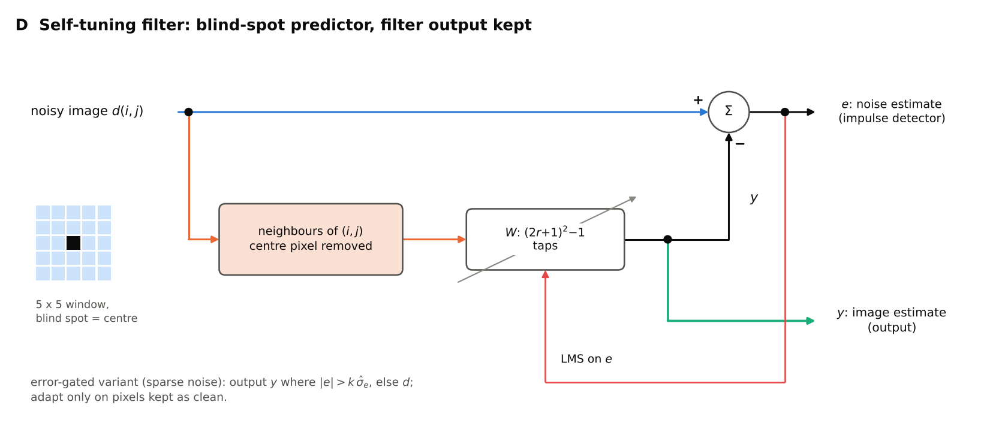

</details>

The wiring is the same as in C, but the filter output is kept. In an image the delay becomes a blind spot: each
pixel is predicted from its neighbours without itself, so the image is predictable and white noise is not. For
sparse noise, the error output acts as an impulse detector. The gated variant replaces only the flagged pixels
and adapts only on clean ones.

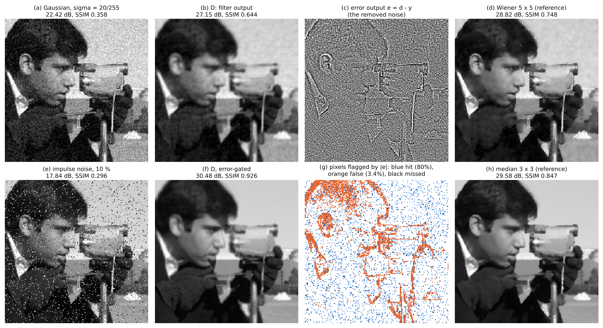


### E. Adaptive line enhancer
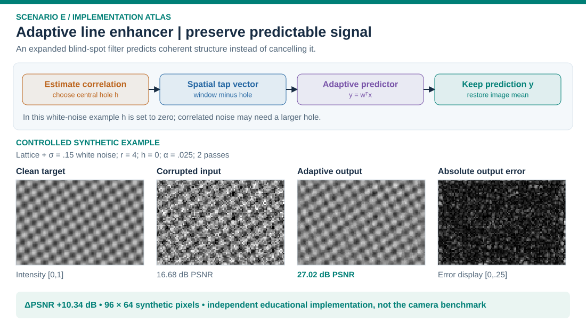

<details>
<summary>Classical adaptive-filter block diagram</summary>


</details>

E is the quantitative form of D. With $L$ weights and prediction distance $\Delta$, the converged filter is a
band-pass on each spectral line with peak gain $G = (L/2)\,\mathrm{SNR}/((L/2)\,\mathrm{SNR}+1)$, for a non-DC, non-Nyquist DFT-bin line in white noise; this agrees with the illustrated Wiener–Hopf calculation. In 2-D, $L$ is the window size and $\Delta$ the blind spot.
The blind spot must outlast the noise correlation, and it is chosen from the measured correlation.

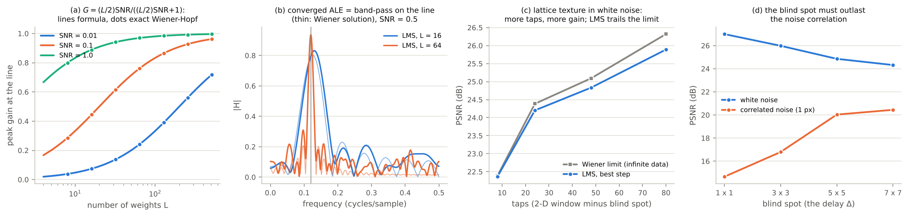
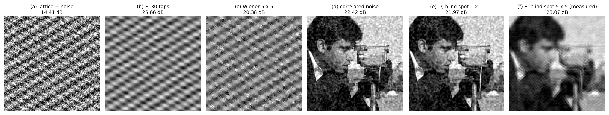

### F. Reference-sensor canceller
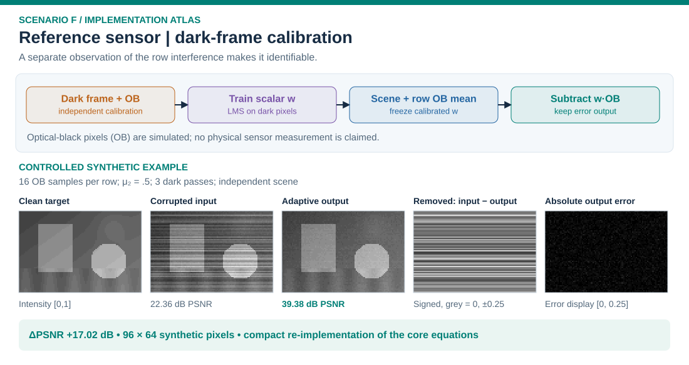

<details>
<summary>Classical adaptive-filter block diagram</summary>

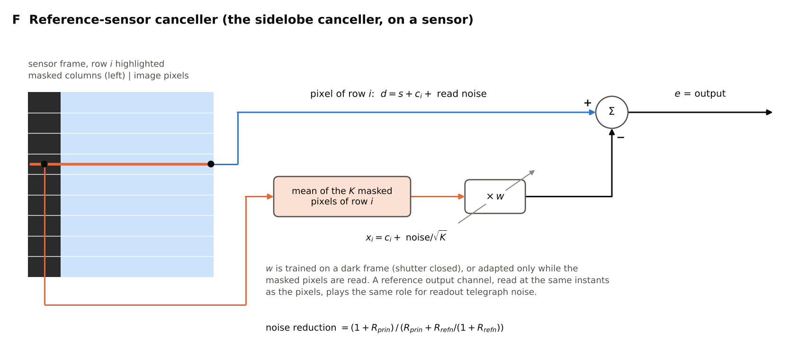

</details>

A sensor that sees the interference but not the scene is the ideal reference. Image sensors have two:
optical-black columns, which see each row's offset, and a reference output channel, which sees the switching
of the shared output amplifier. The default weights are trained on a separate simulated dark frame and then frozen. Scene-based adaptation can be unreliable because scene energy increases gradient noise and finite-sample correlation can bias the estimate.


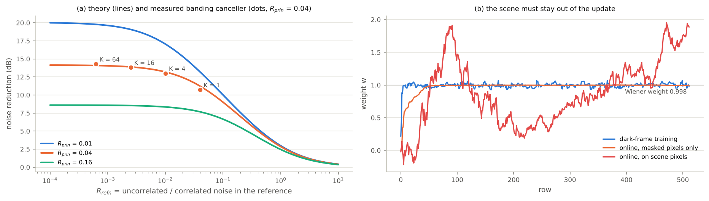

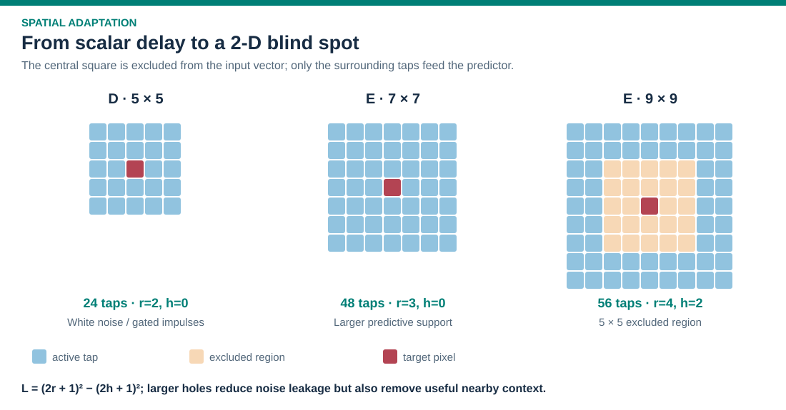


## The corruptions

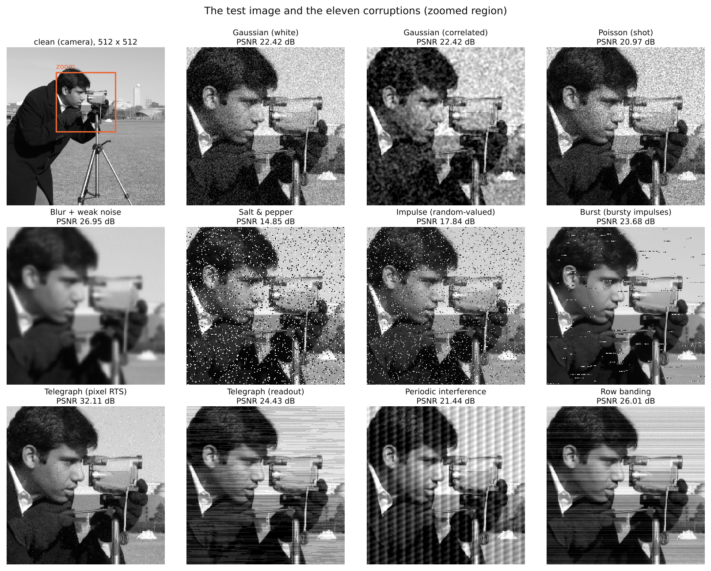

Each model, its parameters, its physics and the scenario that fits it are described in
[docs/noise_models.md](docs/noise_models.md). Their spectra show why each scenario fits where it does:
periodic interference is a set of points, row banding is a line along $v = 0$, readout telegraph noise is a
band around $v = 0$, and white noise is flat.

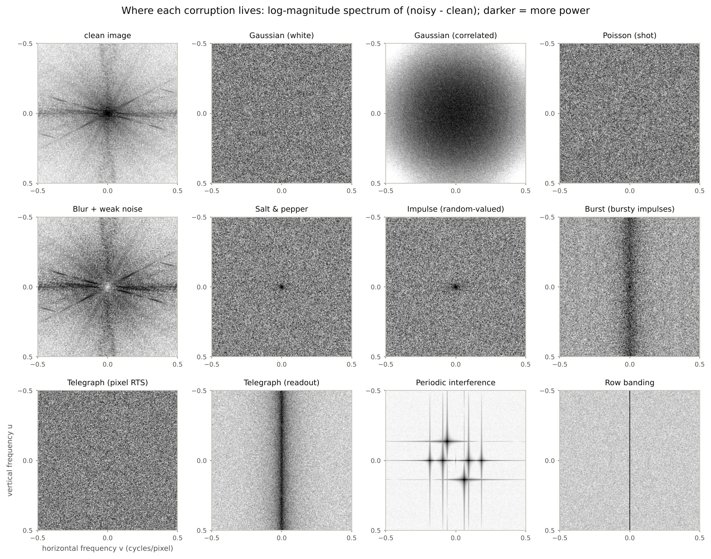


## All corruptions at once

When one image carries every corruption, the scenarios chain naturally. First the interference that has a
physical reference (F, twice), then the deterministic periodic part (A), then the sparse part (D, gated), and
finally the broadband rest (E). The cascade raises PSNR from 17.03 dB to 26.98 dB. The best single
non-adaptive filter reaches 22.42 dB.

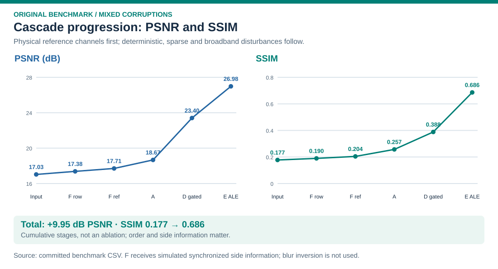

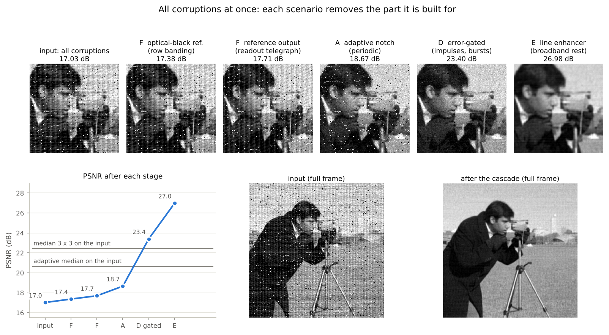

## Additional reproducible examples

The atlas is built with `node tools/build_atlas.cjs` (Node.js 18+, no dependencies). To produce additional image panels with the original Python algorithms, run `python python/extended_examples.py --image data/camera.png --size 256 --seed 0` after installing the existing requirements. Both tools keep their generated artifacts separate from the original benchmark. The optional Python script accepts a different local image and seed. See [instructions](docs/implementation_atlas.md#4-reproduce-or-extend).

## Repository layout

```
python/
  adaptive_denoise/          the package
    noise.py                 eleven noise models + the all-noise mixture, with side information
    scenario_a.py ... _f.py  the six scenarios
    predictor.py             2-D blind-spot LMS predictor (used by D and E), noise-correlation estimate
    spectral.py              averaged 2-D spectrum, periodic-peak detection
    baselines.py             median 3 x 3, adaptive median, local Wiener
    inverse_model.py         adaptive inverse modelling for blur
    pipeline.py              one call per scenario, and the cascade
    metrics.py, imageio.py, plotstyle.py
  run_benchmark.py           every scenario x every noise -> results/benchmark_python.{csv,md}
  make_figures.py            figures/results/*.png
  make_diagrams.py           figures/diagrams/*.png
  extended_examples.py       optional additional runs with original algorithms
matlab/                      the same algorithms, base MATLAB only (no toolboxes)
  run_benchmark.m            every scenario x every noise -> results/benchmark_matlab.csv
  demo_scenarios.m           one figure per scenario + the cascade -> results/matlab_figures/
docs/                        theory, worked examples, evaluation protocol
figures/atlas/               supplemental vector diagrams and image examples
tools/build_atlas.cjs        deterministic, dependency-free atlas generator
results/atlas_synthetic.csv  supplemental synthetic scores
data/camera.png              test image (CC0)
```

## Running it

**Python** (3.9 or newer):

```bash
pip install -r requirements.txt
cd python
python run_benchmark.py      # about a minute; writes results/ and caches outputs
python make_figures.py       # all result figures (or e.g.: python make_figures.py A F)
python make_diagrams.py      # block diagrams
```

```python
from adaptive_denoise import noise, scenario_a
from adaptive_denoise.imageio import load_test_image
x, _ = load_test_image()
nz = noise.make("periodic", x)               # nz.y: noisy image, nz.side: side information
clean, freqs = scenario_a.adaptive_notch(nz.y)
```

**MATLAB** (R2016b or newer, no toolboxes): open `matlab/` and run `run_benchmark` or `demo_scenarios`.
The functions mirror the Python ones one to one (`make_noisy`, `adaptive_notch`, `interline_canceller`,
`subband_canceller`, `self_tuning`, `self_tuning_gated`, `line_enhancer`, `train_row_weight`,
`channel_reference_canceller`, ...). The algorithms and parameters are identical. The random streams differ,
so the noisy images and the numbers differ slightly from the Python run.

**Your own image.** Put it in `data/` as `lena.png`, and both languages use it in place of `camera.png`.
Color images are converted to gray, and images of other sizes are resized to 512 x 512. Any other file can be
passed to `load_test_image(path)`. Rerun the benchmark and the figures to regenerate everything.
