# Adaptive Filters for Image Denoising

[](https://github.com/VKHS/Adaptive-Filters-for-Image-Denoising/actions/workflows/hardware.yml)
[](LICENSE)
[](https://orcid.org/0000-0003-4870-2768)

**Abdolvahab Khalili Sadaghiani** · ORCID [0000-0003-4870-2768](https://orcid.org/0000-0003-4870-2768)

One LMS adaptive noise canceller, six ways of wiring it, carried from one-dimensional signals to images. Every
configuration is implemented in **Python** and **MATLAB**, explained with its block diagram and theory, scored
on a test image under eleven kinds of corruption, shown on a real-world application, and mapped to
**fixed-point Verilog**.

<p align="center">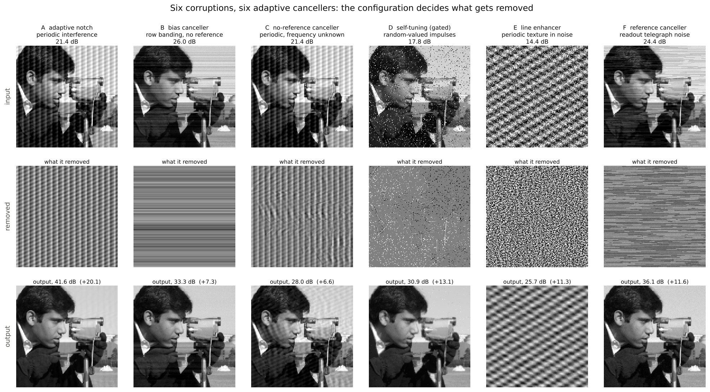</p>

The corruptions: Gaussian noise (white and correlated), Poisson noise, blur, salt and pepper, random-valued
impulses, bursts, telegraph noise (pixel and readout), periodic interference and row banding. Each is applied
alone, and then all of them together.

**Contents:** [the idea](#the-idea) ·
[which scenario?](#which-scenario) ·
[at a glance](#the-six-scenarios-at-a-glance) ·
[first in 1-D](#first-in-one-dimension) ·
[benchmark](#which-scenario-removes-which-corruption) ·
[the six scenarios](#the-scenarios) ·
[application examples](#application-examples) ·
[watching it learn](#watching-it-learn) ·
[the corruptions](#the-corruptions) ·
[all at once](#all-corruptions-at-once) ·
[hardware](#hardware-architecture-and-verilog-implementations) ·
[layout](#repository-layout) ·
[running it](#running-it) ·
[citation](#citation) ·
[license](#license)

## The idea

<p align="center"></p>

The canceller has two inputs. The **primary** $d = s + n$ carries the image $s$ and the noise $n$. The
**reference** $x$ is correlated with $n$ but not with $s$. An adaptive filter turns $x$ into an estimate
$y = \hat n$, and the output is $e = d - y$. Because $s$ is uncorrelated with $x$,

$$E[e^2] = E[s^2] + E[(n - \hat n)^2],$$

so minimising the output power, which LMS does with $w \leftarrow w + \mu_2\, e\, x$, minimises the noise
error without ever seeing $s$. The six scenarios differ in **where the reference comes from** and **which
output is kept**. The theory is in [docs/0_principle.md](docs/0_principle.md).

## Which scenario?

<p align="center">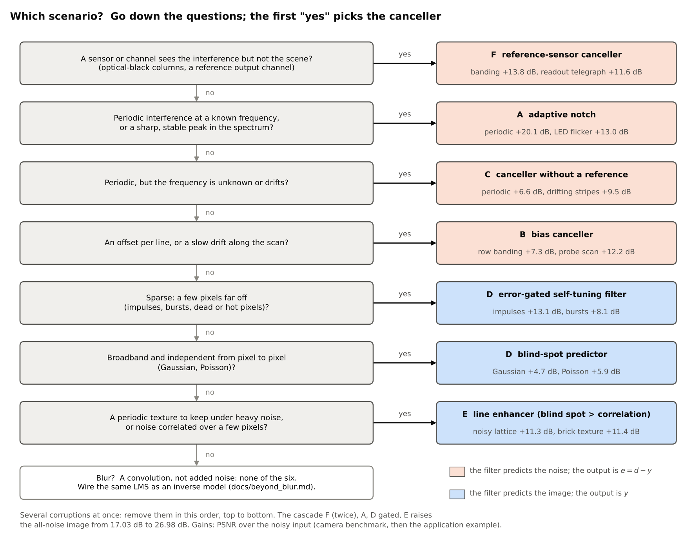</p>

Go down the questions; the first "yes" picks the configuration. The order is also the order in which a
mixed corruption is removed: interference with a physical reference first, then the deterministic periodic
part, then drift, then the sparse part, and the broadband rest last. In A, B, C and F the filter predicts the
interference and the error is kept; in D and E it predicts the image and its output is kept.

## The six scenarios at a glance

| | Scenario | Reference | Output kept | Image form | Fits | Benchmark | Application example |
|---|---|---|---|---|---|---|---|
| **A** | [Adaptive notch](docs/A_adaptive_notch.md) | synthetic $\cos/\sin$ at the interference frequency | error | 2-D plane-wave reference in raster order; frequencies known or detected | stripes, moire, flicker | **+20.1 dB** periodic | [LED flicker](docs/examples.md#a-led-flicker-in-a-rolling-shutter-camera): 22.4 → 35.4 dB |
| **B** | [Bias / drift canceller](docs/B_bias_drift.md) | constant 1 | error | line-to-line bias weight, high-pass across rows | row offsets, drift | +7.3 dB row banding | [probe microscopy](docs/examples.md#b-line-offsets-and-drift-in-a-probe-microscopy-scan): 22.4 → 34.6 dB |
| **C** | [Periodic interference without a reference](docs/C_periodic_noref.md) | delayed primary | error | delayed canceller on the high band of each row | periodic interference, frequency unknown | +6.6 dB periodic | [drifting stripes](docs/examples.md#c-vibration-stripes-whose-frequency-drifts): 23.0 → 32.5 dB |
| **D** | [Self-tuning filter](docs/D_self_tuning.md) | delayed primary | filter output | blind-spot predictor; error-gated variant for sparse noise | white noise; impulses, bursts (gated) | +5.9 dB Poisson, **+13.1 dB** impulses (gated) | [impulses on texture](docs/examples.md#d-bit-errors-dead-and-hot-pixels-on-fine-texture): 19.2 → 31.0 dB |
| **E** | [Adaptive line enhancer](docs/E_line_enhancer.md) | delayed primary, $L$ taps | filter output | larger window, blind spot sized to the noise correlation | periodic texture in noise, correlated noise | +11.3 dB noisy lattice | [brick texture](docs/examples.md#e-a-periodic-texture-under-heavy-noise): 18.4 → 29.8 dB |
| **F** | [Reference-sensor canceller](docs/F_reference_canceller.md) | a sensor that sees only the interference | error | optical-black columns, reference output channel | banding, readout telegraph | **+13.8 dB** banding, **+11.6 dB** telegraph | [astronomy](docs/examples.md#f-row-banding-and-readout-telegraph-noise-on-a-faint-field): 27.9 → 36.3 dB |

All gains are PSNR improvements over the noisy input, with fixed default parameters; the clean image only
generates the corruptions and scores the results. F receives simulated reference channels and a separate dark
frame for calibration.

## First in one dimension

<p align="center">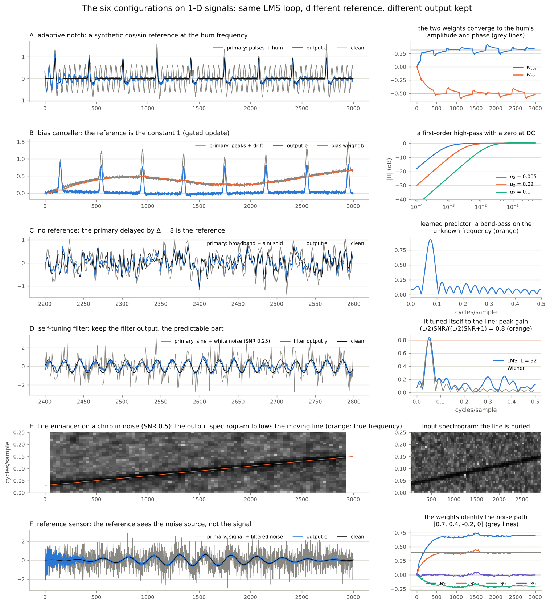</p>

The same LMS loop on 1-D signals, before any image enters:

* **A** removes mains hum from a pulse train. Two weights on $\cos$ and $\sin$ at the hum frequency converge to
  the hum's amplitude and phase.
* **B** removes a drifting baseline under sharp peaks. The reference is the constant 1, the weight follows the
  baseline, and the canceller is a first-order high-pass with a zero at DC.
* **C** removes a sinusoid of unknown frequency. The primary delayed by $\Delta$ = 8 is the reference; the
  predictor becomes a band-pass on the sinusoid and the error keeps the broadband signal.
* **D** keeps the other output: a sine buried in white noise (SNR 0.25) comes out of the filter, which tuned
  itself to the line with the predicted peak gain $(L/2)\mathrm{SNR}/((L/2)\mathrm{SNR}+1) = 0.8$.
* **E** follows a chirp in noise: the output spectrogram tracks the moving line that the input hides.
* **F** cancels noise that reached the primary through an unknown path. The reference sees the noise source,
  and the weights identify the path $[0.7, 0.4, -0.2]$.

## Which scenario removes which corruption

<p align="center"></p>

The figure reads row by row. Each kind of interference is removed by the configuration whose reference matches
its structure:

* **Narrowband interference** has a deterministic reference. With a known or detected frequency, the notch (A)
  removes it almost completely; the result is limited by the image content inside the notch. Without one, the
  no-reference canceller (C) still gains 6.6 dB.
* **Interference with a physical reference** is cancelled by F close to the two-input theory: 39.76 dB measured
  against 39.90 dB predicted for banding, and 36.05 dB against 36.13 dB for readout telegraph noise.
  Without the reference, nothing else touches readout telegraph noise. For banding, B is the
  reference-free fallback.
* **Broadband noise** (white Gaussian, Poisson) suits the self-tuning filter D and the line enhancer E:
  +4.7 to +5.9 dB. They trail a local Wiener filter on white Gaussian noise (27.15 dB against 28.82 dB) and
  beat it on Poisson noise (26.83 dB against 24.76 dB).
* **Sparse noise** (impulses, bursts, salt and pepper) breaks plain LMS. Used as a detector, the error output
  turns D into the best filter here for random-valued impulses (30.94 dB) and bursts (31.76 dB). The adaptive
  median keeps the edge on salt and pepper (33.16 against 32.23 dB), because it exploits the fact that those
  pixels sit at exactly 0 or 1.
* **Blur** is a convolution, not additive interference, and none of the six removes it. The same LMS machinery
  wired as an inverse model does: see [docs/beyond_blur.md](docs/beyond_blur.md).

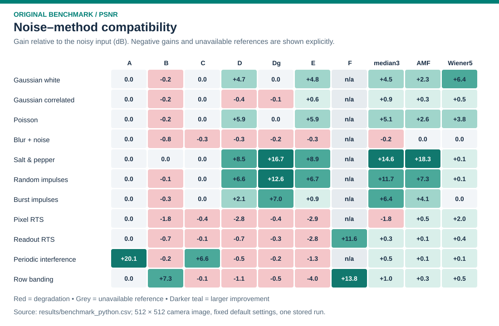

The [PSNR summary](results/benchmark_python.md) includes the cascade SSIM, and the
[complete CSV](results/benchmark_python.csv) per-method PSNR, SSIM, gain and timing. The
[evaluation protocol](docs/evaluation_protocol.md) gives the metric conventions and what each result supports.

## The scenarios

Each scenario opens with its implementation panel: the data flow, the update and a 96 × 64 worked example, with
the settings and PSNR printed in the panel ([generator](tools/build_atlas.cjs),
[scores](results/atlas_synthetic.csv)). The 512 × 512 results, the theory figures and the classical block
diagram follow. The [implementation atlas](docs/implementation_atlas.md) works through each update with
numbers.


### A. Adaptive notch filter


<details>
<summary>Classical adaptive-filter block diagram</summary>


</details>

A pair of synthetic references, $C\cos\theta$ and $C\sin\theta$, lets two weights build any amplitude and
phase at the interference frequency. In an image, $\theta = 2\pi(u i + v j)$ is a plane wave scanned in raster
order. The weights learn amplitude and phase once and keep them from row to row. Frequencies are found as sharp
peaks of the averaged 2-D spectrum.


The notch has zeros on the unit circle and a width of about $\mu_2 C^2$ rad/sample. A narrower notch removes
less image, but it needs a more exact frequency:

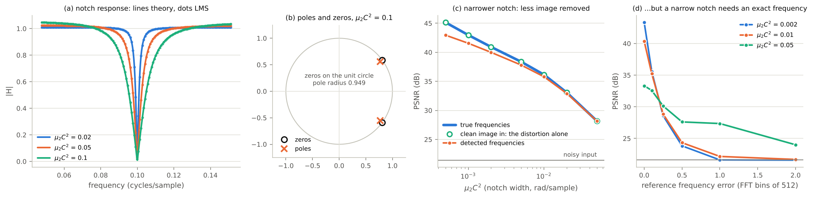

### B. Bias (drift) canceller


<details>
<summary>Classical adaptive-filter block diagram</summary>


</details>

One weight on a constant reference is a first-order high-pass, $H(z) = (z-1)/(z-(1-\mu_2))$. Run along scan
lines, it cannot tell drift from scene brightness, so it works only on flat backgrounds such as probe
microscopy and documents, and only once the update is gated to background pixels. For row banding on natural
images, the bias weight runs line to line, and a high-pass across rows protects slow shading.

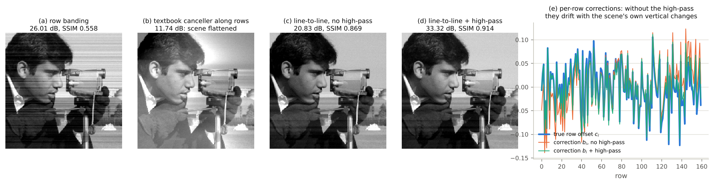


### C. Periodic interference without a reference
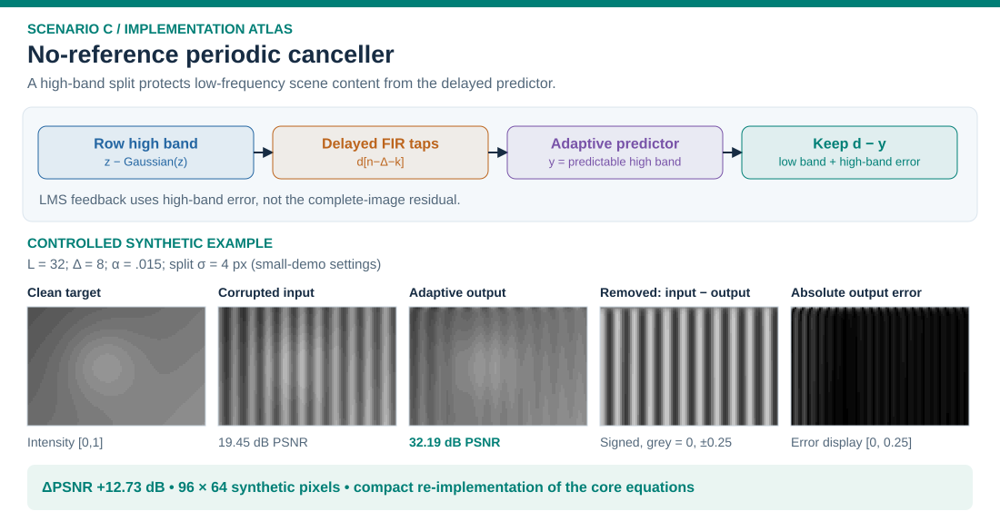

<details>
<summary>Classical adaptive-filter block diagram</summary>

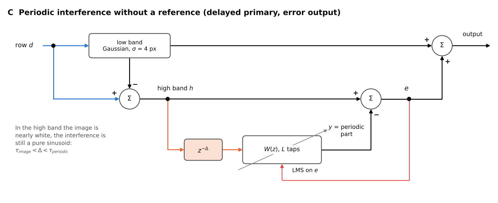

</details>

The delayed primary serves as the reference. The broadband part decorrelates within the delay and the
periodic part does not, so the error output keeps the broadband part. On raw image rows the image itself is
predictable and gets cancelled too, giving 15.96 dB from 21.44 dB. Run on the high band of each row, where the
scene is close to white, the canceller finds the interference lines by itself and reaches 28.04 dB.

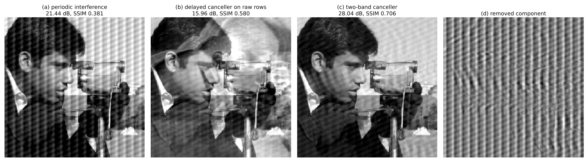
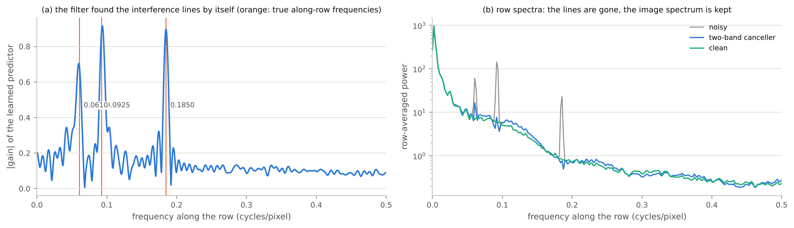

### D. Self-tuning filter
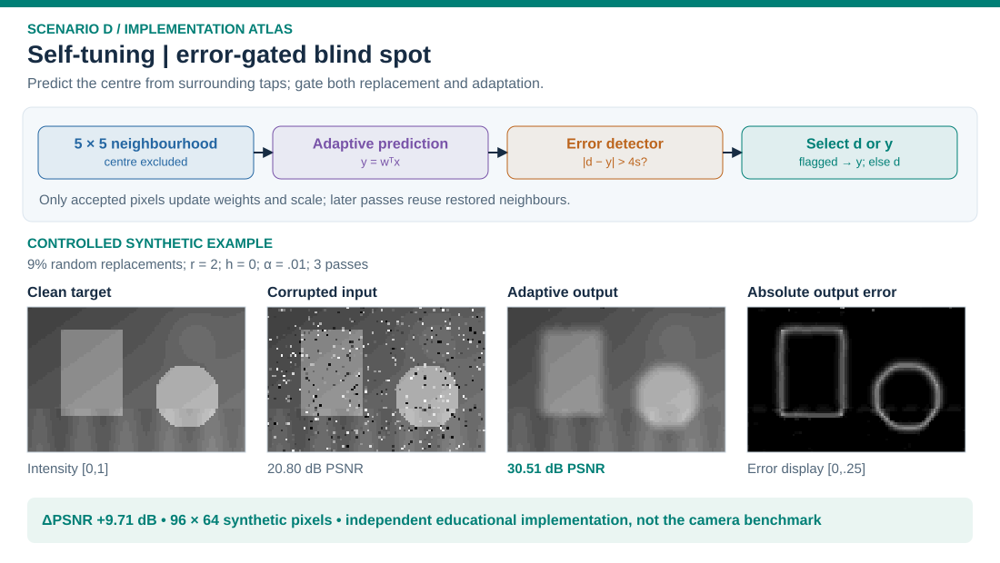

<details>
<summary>Classical adaptive-filter block diagram</summary>


</details>

The wiring is the same as in C, but the filter output is kept. In an image the delay becomes a blind spot: each
pixel is predicted from its neighbours without itself, so the image is predictable and white noise is not. For
sparse noise, the error output acts as an impulse detector. The gated variant replaces only the pixels where
$|e| > \max(4\hat\sigma_e, 0.1)$ and adapts only on the others; above about 10 % impulses, $k = 3$ is the
better threshold ([density sweep](docs/examples.md#d-bit-errors-dead-and-hot-pixels-on-fine-texture)).


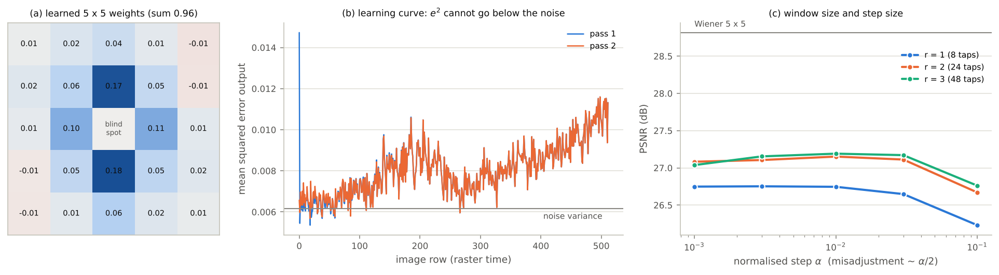

### E. Adaptive line enhancer


<details>
<summary>Classical adaptive-filter block diagram</summary>

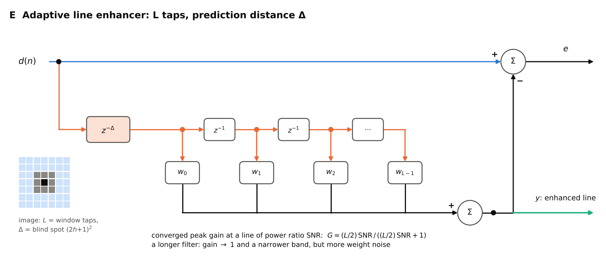

</details>

E is the quantitative form of D. With $L$ weights and prediction distance $\Delta$, the converged filter is a
band-pass on each spectral line with peak gain $G = (L/2)\,\mathrm{SNR}/((L/2)\,\mathrm{SNR}+1)$, for a non-DC,
non-Nyquist DFT-bin line in white noise; this agrees with the illustrated Wiener–Hopf calculation. In 2-D, $L$
is the window size and $\Delta$ the blind spot. The blind spot must outlast the noise correlation, and it is
chosen from the measured correlation.


### F. Reference-sensor canceller


<details>
<summary>Classical adaptive-filter block diagram</summary>


</details>

A sensor that sees the interference but not the scene is the ideal reference. Image sensors have two:
optical-black columns, which see each row's offset, and a reference output channel, which sees the switching
of the shared output amplifier. The weights are trained on a separate dark frame and then frozen. The scene is
far stronger than the interference, so adapting on it needs a very small step, and for banding, where the
reference is one number per row, the weight wanders; finite-sample correlation between scene and reference can
also bias the estimate.

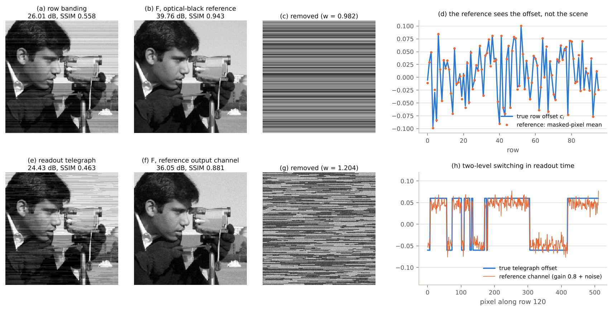


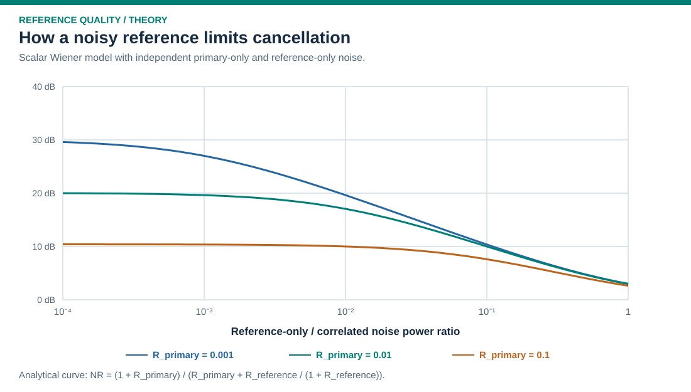

## Application examples

Each configuration on the kind of problem it was built for, on an image that suits it, next to the best
alternative on the same input. The physics, settings and numbers are in [docs/examples.md](docs/examples.md).

**A. LED flicker in a rolling-shutter camera.** The bands multiply the scene, so the notch runs in the log
domain, at the frequency the sensor timing gives.


**B. Probe-microscopy scan.** Line offsets and drift along each fast-scan line. The gated update follows the
substrate and holds still across particles.

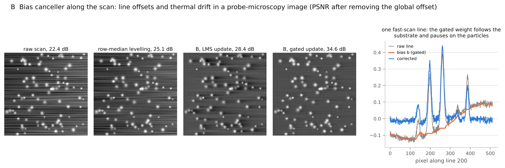

**C. Stripes whose frequency drifts.** No reference and no spectral peak for A to find; the delayed-primary
canceller tracks the drift.


**D. Bit errors, dead and hot pixels on fine texture.** Only the flagged pixels change, so the texture
survives.

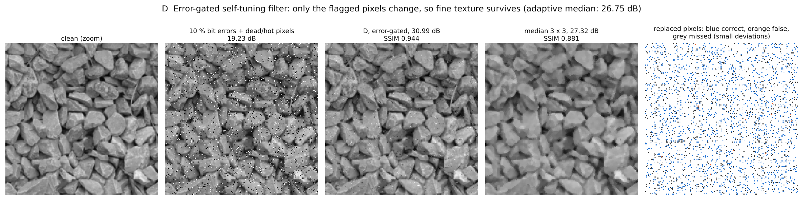

**E. A periodic texture under heavy noise.** An 11 × 11 window predicts the pattern from its repetitions.


**F. A faint astronomical field.** Optical-black columns and a reference output channel remove the banding and
the telegraph steps that hide the galaxies.

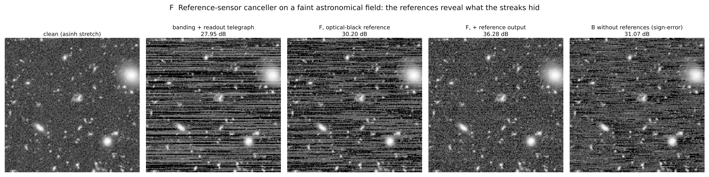

## Watching it learn

<table>
<tr>
<td width="50%">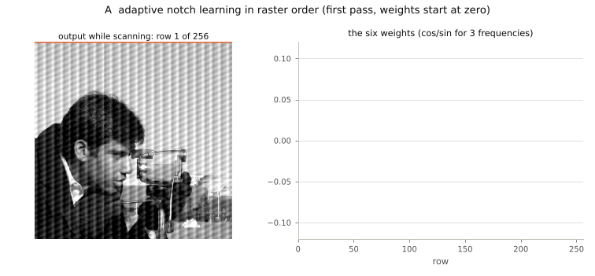</td>
<td width="50%">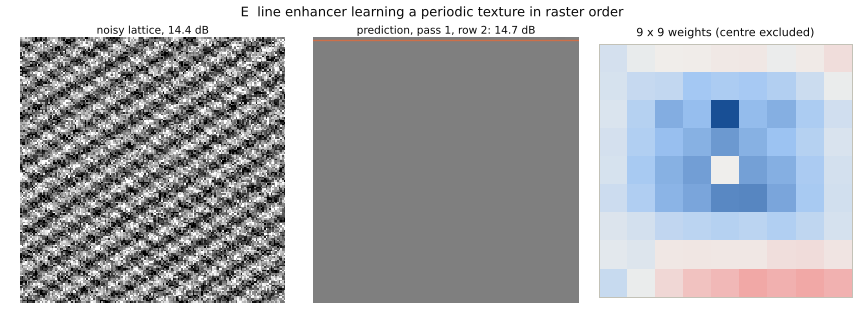</td>
</tr>
<tr>
<td>A in raster order, weights starting at zero: the stripes fade within the first rows, as the six weights
lock on to the amplitude and phase of three interference frequencies.</td>
<td>E on a noisy lattice: the 9 × 9 weights take on the lattice's period, and the prediction sharpens pass by
pass (14.4 to 25.7 dB).</td>
</tr>
</table>

## The corruptions


Each model, its parameters, its physics and the scenario that fits it are described in
[docs/noise_models.md](docs/noise_models.md). Their spectra show why each scenario fits where it does:
periodic interference is a set of points, row banding is a line along $v = 0$, readout telegraph noise is a
band around $v = 0$, and white noise is flat.


## All corruptions at once

When one image carries every corruption, the scenarios chain naturally. First the interference that has a
physical reference (F, twice), then the deterministic periodic part (A), then the sparse part (D, gated), and
finally the broadband rest (E). The cascade raises PSNR from 17.03 dB to 26.98 dB. The best single
non-adaptive filter reaches 22.42 dB.


## Hardware architecture and Verilog implementations

The [fixed-point hardware subsystem](hardware/README.md) maps the six configurations to synthesizable
Verilog-2005 processing cores and the image-stream components around them. Five share a resource-reused serial
LMS engine; the scalar bias estimator has its own datapath.


| A | B | C | D | E | F |
|---|---|---|---|---|---|
| [Notch RTL](hardware/docs/A_notch.md) | [Bias RTL](hardware/docs/B_bias.md) | [Delayed FIR RTL](hardware/docs/C_periodic.md) | [Self-tuning RTL](hardware/docs/D_self_tuning.md) | [Enhancer RTL](hardware/docs/E_line_enhancer.md) | [Reference RTL](hardware/docs/F_reference.md) |

[RTL source files](hardware/rtl/) · [Six scenario testbenches](hardware/tb/) · [Fixed-point golden model](hardware/model/fixed_model.py) · [Smoke-test guide](hardware/docs/verification.md) · [Integration and memory planning](hardware/docs/integration.md)

```bash
python3 hardware/model/fixed_model.py      # integer golden model: 938 transactions
bash hardware/run_smoke.sh                 # Icarus Verilog testbenches
bash hardware/run_synth.sh                 # Yosys synthesis checks
```

Arithmetic is Q12 in 16-bit words with power-of-two steps. GitHub Actions runs every testbench and the
synthesis checks on each change to `hardware/` (badge above). Place-and-route results for a specific FPGA are
not part of this layer.

## Repository layout

```
python/
  adaptive_denoise/          the package
    noise.py                 eleven noise models + the all-noise mixture, with side information
    scenario_a.py ... _f.py  the six scenarios
    predictor.py             2-D blind-spot LMS predictor (used by D and E), noise-correlation estimate
    spectral.py              averaged 2-D spectrum, periodic-peak detection
    baselines.py             median 3 x 3, adaptive median, local Wiener
    inverse_model.py         adaptive inverse modelling for blur
    pipeline.py              one call per scenario, and the cascade
    metrics.py, imageio.py, plotstyle.py
  run_benchmark.py           every scenario x every noise -> results/benchmark_python.{csv,md}
  make_figures.py            figures/results/*.png
  make_diagrams.py           figures/diagrams/*.png, including the decision guide
  make_examples.py           application examples, overview figures, animations, density sweep
  extended_examples.py       additional runs of the pipeline on any image and seed
matlab/                      the same algorithms, base MATLAB only (no toolboxes)
  run_benchmark.m            every scenario x every noise -> results/benchmark_matlab.csv
  demo_scenarios.m           one figure per scenario + the cascade -> results/matlab_figures/
  demo_examples.m            the six application examples -> results/matlab_figures/
hardware/                    fixed-point Verilog cores, testbenches, golden model, docs
docs/                        theory, scenario pages, application examples, worked examples, protocol
figures/overview/            hero figure and the 1-D view
figures/examples/            application examples
figures/animations/          the adaptation in raster order
figures/atlas/               implementation panels (vector)
tools/build_atlas.cjs        deterministic, dependency-free atlas generator
data/camera.png              benchmark test image (CC0)
data/examples/               example images (CC0 / public domain)
LICENSE                      MIT License
CITATION.cff                 citation metadata, with the author's ORCID iD
```

## Running it

**Python** (3.9 or newer):

```bash
pip install -r requirements.txt
cd python
python run_benchmark.py      # about a minute; writes results/ and caches outputs
python make_figures.py       # all result figures (or e.g.: python make_figures.py A F)
python make_diagrams.py      # block diagrams and the decision guide
python make_examples.py      # application examples, overview, animations (or: examples | hero | oned | gifs | density)
```

```python
from adaptive_denoise import noise, scenario_a
from adaptive_denoise.imageio import load_test_image
x, _ = load_test_image()
nz = noise.make("periodic", x)               # nz.y: noisy image, nz.side: side information
clean, freqs = scenario_a.adaptive_notch(nz.y)
```

Each scenario page has a short *Try it* block in both languages.

**MATLAB** (R2016b or newer, no toolboxes): open `matlab/` and run `run_benchmark`, `demo_scenarios` or
`demo_examples`. The functions mirror the Python ones one to one (`make_noisy`, `adaptive_notch`,
`interline_canceller`, `subband_canceller`, `self_tuning`, `self_tuning_gated`, `line_enhancer`,
`train_row_weight`, `channel_reference_canceller`, ...). The algorithms and parameters are identical. The
random streams differ, so the noisy images and the numbers differ slightly from the Python run.

**The atlas** is rebuilt with `node tools/build_atlas.cjs` (Node.js 18+, no dependencies).
`python python/extended_examples.py --image data/camera.png --size 256 --seed 0` reruns the pipeline on any
image and seed ([instructions](docs/implementation_atlas.md#4-reproduce-or-extend)).

**Your own image.** Put it in `data/` as `lena.png`, and both languages use it in place of `camera.png`.
Color images are converted to gray, and images of other sizes are resized to 512 x 512. Any other file can be
passed to `load_test_image(path)`. Rerun the benchmark and the figures to regenerate everything.

## Citation

GitHub's **Cite this repository** button reads [CITATION.cff](CITATION.cff). In BibTeX:

```bibtex
@software{KhaliliSadaghiani_AdaptiveFilters_2026,
  author  = {Khalili Sadaghiani, Abdolvahab},
  title   = {Adaptive Filters for Image Denoising},
  year    = {2026},
  url     = {https://github.com/VKHS/Adaptive-Filters-for-Image-Denoising},
  license = {MIT},
  note    = {ORCID: 0000-0003-4870-2768}
}
```

## License

The code, documentation and figures are released under the [MIT License](LICENSE), © 2026 Abdolvahab Khalili
Sadaghiani. The test images in `data/` are CC0 or public domain and keep those terms.
