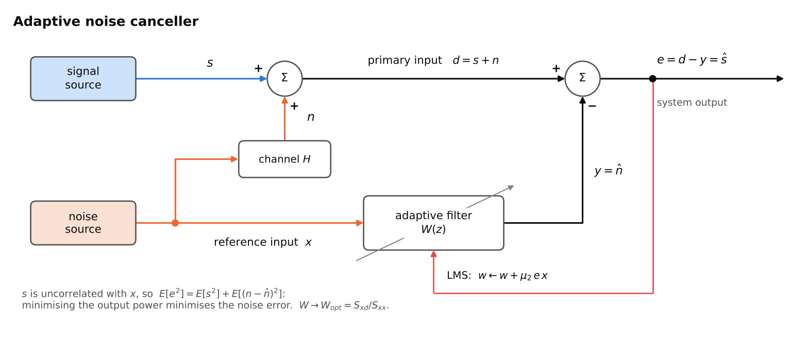

# The adaptive noise canceller: principle, theory, and how it maps to images

[back to README](../README.md)

## 1. Two inputs, one output

A signal source produces $s$, a noise source produces $n_0$, and the noise reaches the primary sensor through
an unknown channel $H$:

* **primary input** $d = s + n$, with $n = H\,n_0$;
* **reference input** $x$, correlated with $n$ and uncorrelated with $s$ (here $x = n_0$);
* **adaptive filter** $W(z)$ turns $x$ into $y = \hat n$;
* **output** $e = d - y = \hat s$. The output is also the error that drives the adaptation.

Squaring and taking expectations, the cross term $E[s\,(n-y)]$ vanishes because $s$ is uncorrelated with both
$n$ and $y$:

$$E[e^2] = E[s^2] + E[(n - y)^2].$$

$E[s^2]$ does not depend on the filter, so **minimising the output power minimises the noise-estimation error**.
The canceller never needs to know $s$. The same identity explains every failure in the image experiments:
whenever part of the image leaks into the reference, or is predictable from it, that part of the image is
"noise" to the canceller and is removed.

## 2. The optimal filter

For an unconstrained (two-sided, infinitely long) filter, the minimum of $E[e^2]$ is the Wiener solution

$$W_{opt}(e^{j\omega}) = \frac{S_{xd}(e^{j\omega})}{S_{xx}(e^{j\omega})}.$$

With a clean reference ($x = n_0$) this is $W_{opt} = H$: the filter models the channel. If the reference is
itself the output of a filter $G$ acting on the noise, the filter becomes $H/G$, which includes inverting
whatever stands between noise and reference. The same identity, applied to a blurred calibration target, gives
Wiener deconvolution (see [beyond_blur.md](beyond_blur.md)).

For an FIR filter with tap vector $\mathbf x(n)$ the normal equations are

$$\mathbf R\,\mathbf w_o = \mathbf p, \qquad \mathbf R = E[\mathbf x \mathbf x^T],\ \ \mathbf p = E[d\,\mathbf x].$$

## 3. Uncorrelated noise in either input

Real inputs carry noise that the other input does not see: read noise in the primary, the reference sensor's
own noise. Let $R_{prin}$ be the ratio of uncorrelated to correlated noise power in the primary, and $R_{refn}$
the same ratio in the reference. The converged canceller leaves

$$\text{output noise} = S_{nn}\left[R_{prin} + \frac{R_{refn}}{R_{refn}+1}\right],$$

so the noise-power reduction is

$$\mathrm{NR} = \frac{1+R_{prin}}{R_{prin} + R_{refn}/(1+R_{refn})}.$$

Two consequences used throughout:

* the uncorrelated noise of the primary cannot be cancelled, so $\mathrm{NR} \le 1 + 1/R_{prin}$;
* a noisy reference costs gain only through $R_{refn}/(1+R_{refn})$, so averaging $K$ reference pixels divides
  $R_{refn}$ by $K$ (scenario F).

Scenario F measures both: 39.76 dB against 39.90 dB predicted for row banding, and 36.05 dB against 36.13 dB
for readout telegraph noise.

**Signal leakage.** If part of the signal also reaches the reference, the canceller removes it in proportion.
The distortion is about $\rho_{ref}/\rho_{pri}$, the ratio of the signal-to-noise ratios in the two inputs.
This is why a reference must be "dark": optical-black pixels, a dark frame, a sensor aimed at the interferer.

## 4. LMS

Steepest descent on $E[e^2]$ with the instantaneous gradient $-2e\,\mathbf x$ gives the LMS update, written here
with the full step $\mu_2$:

$$\mathbf w(n+1) = \mathbf w(n) + \mu_2\, e(n)\, \mathbf x(n).$$

* **Stability** in the mean: $0 < \mu_2 < 2/\lambda_{max}$, with $\lambda_{max}$ the largest eigenvalue of
  $\mathbf R$.
* **Speed:** each eigenmode converges with time constant $\tau_k \approx 1/(\mu_2 \lambda_k)$. A large eigenvalue
  spread, as with strongly correlated pixels or a blurred input, makes the slow modes very slow.
* **Misadjustment:** the gradient noise adds an excess error
  $M = \text{excess MSE} / \text{MSE}_{min} \approx \mu_2\,\mathrm{tr}(\mathbf R)/2$.

The code uses a **normalised step** $\alpha = \mu_2\,L\,\sigma_x^2 = \mu_2\,\mathrm{tr}(\mathbf R)$, so that
$M \approx \alpha/2$ whatever the image's contrast.

**The minimum MSE matters as much as the step.** The excess error is $M$ times the minimum MSE, and in an image
canceller that minimum includes the scene, which is uncorrelated with the reference. When the scene is much
stronger than the interference, as with banding and readout telegraph noise, $\mu_2$ must be tiny for the
weights to settle. Training on a dark frame removes the scene from the update altogether (scenario F).

**Robust updates.** Impulses in $e$ make LMS jump. Two remedies appear below: the sign-error update
$\mathbf w \leftarrow \mathbf w + \mu_2\,\mathrm{sgn}(e)\,\mathbf x$, which converges to a median instead of a
mean (scenario B), and gating, which skips the update when $|e|$ is implausibly large (scenarios B and D).

## 5. No reference? Delay the primary

When no separate reference exists, a delayed copy of the primary, $x(n) = d(n-\Delta)$, can play the role.
After the delay the broadband component is decorrelated and the narrowband component is not, provided

$$\tau_{broadband} < \Delta < \tau_{narrowband},$$

with $\tau$ the correlation times. The filter can then predict only the narrowband part, and the choice of output
gives two scenarios:

* **error output**: the narrowband part is removed, so periodic interference is cancelled (scenario C);
* **filter output**: only the narrowband part is kept, so a line is enhanced in broadband noise (scenarios D, E).

## 6. From a time signal to an image

| 1-D canceller | image |
|---|---|
| time $n$ | raster order: row by row, left to right (a sensor's readout order) |
| weights carried in time | weights carried from pixel to pixel and from row to row |
| sinusoid $\cos(\omega_0 n)$ | plane wave $\cos(2\pi(u i + v j))$ |
| constant (bias) | constant along a row, or line to line |
| delay $\Delta$ | blind spot: the centre $(2h+1)^2$ block of a $(2r+1)^2$ window is left out |
| $L$ taps | $(2r+1)^2 - (2h+1)^2$ taps of the 2-D window |
| reference sensor | optical-black columns, reference output channel, dark frame |

The image adds one difficulty the 1-D theory does not have: **images are strongly correlated**. Every image
pixel is "narrowband" with respect to its neighbours, so any structure that relies on decorrelation across a
delay (C, D, E) must be built so that the image falls on the right side of the delay. C uses a high band in
which the image is nearly white. D and E use a blind spot, so that the image is what gets predicted and the
noise is what is left out.

The pages for the six scenarios apply these points one by one:
[A](A_adaptive_notch.md) · [B](B_bias_drift.md) · [C](C_periodic_noref.md) · [D](D_self_tuning.md) ·
[E](E_line_enhancer.md) · [F](F_reference_canceller.md).
