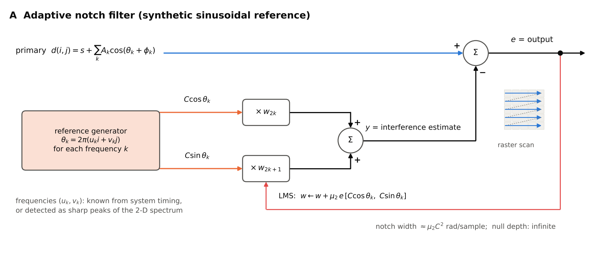
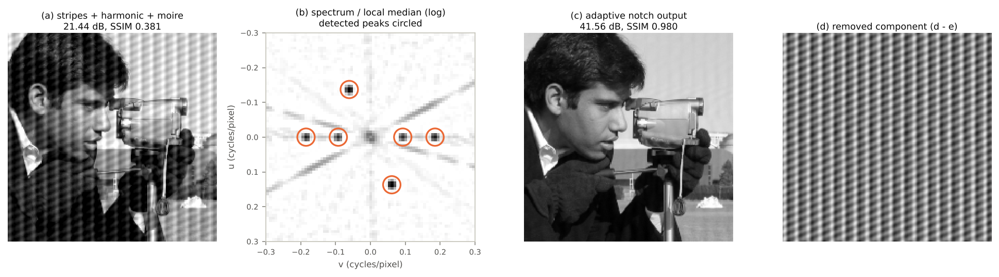
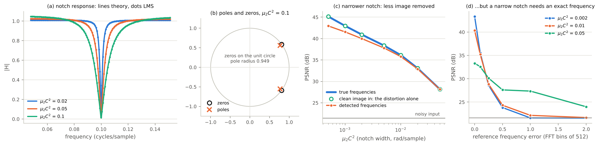
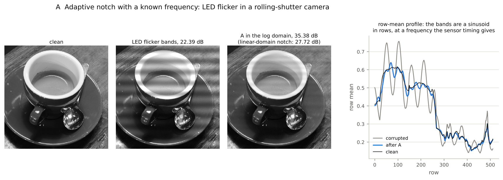
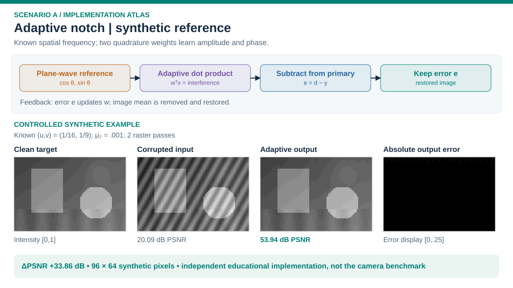

# A. Adaptive notch filter: cancelling sinusoidal interference with a synthetic reference

[back to README](../README.md) · [principle](0_principle.md)

<p align="center"></p>

## Idea

When the interference is a sinusoid of known frequency (mains hum, a carrier, a vibration), no reference sensor
is needed: the reference can be **synthesised**. Take two references in quadrature,

$$x_1(n) = C\cos(\omega_0 n), \qquad x_2(n) = C\sin(\omega_0 n),$$

and two weights. Any sinusoid $A\cos(\omega_0 n + \phi) = w_1 x_1 + w_2 x_2$ for suitable $w_1, w_2$, so the
weights can reproduce the interference whatever its amplitude and phase. Only the frequency must be known. The
output is the error $e = d - w_1x_1 - w_2x_2$, and LMS adapts $w \leftarrow w + \mu_2\,e\,[x_1, x_2]^T$.
Several interfering frequencies simply add more pairs.

## Transfer function

From primary input to output, the closed loop is linear and time-invariant:

$$H(z) = \frac{z^2 - 2\cos\omega_0\, z + 1}{z^2 - 2\left(1 - \tfrac{\mu_2 C^2}{2}\right)\cos\omega_0\, z + 1 - \mu_2 C^2}.$$

* The **zeros** lie exactly on the unit circle at $e^{\pm j\omega_0}$, so the null at $\omega_0$ is infinitely deep.
* The **poles** sit at radius $\approx 1 - \mu_2C^2/2$, just inside the zeros, so the notch is narrow and flat
  elsewhere.
* The **-3 dB width** is about $\mu_2 C^2$ rad/sample, and $Q = \omega_0/(\mu_2C^2)$.
* The notch **tracks**: if the interference frequency drifts slowly, the weights rotate with it.

The measured response of the LMS loop, fed with white noise, falls on the formula (panel a below; the largest
deviation is 0.016 in $|H|$). Panel b shows the pole-zero pattern.

## Image form

A row of an image is a signal in time (the raster order), and periodic interference in an image is a 2-D
sinusoid $A\cos(2\pi(u i + v j) + \phi)$: stripes ($u = 0$), horizontal bands ($v = 0$), or a diagonal moire.
The reference is the same plane wave,

$$x_1(i,j) = C\cos(2\pi(u i + v j)), \qquad x_2(i,j) = C\sin(2\pi(u i + v j)),$$

scanned in raster order with the weights carried from row to row. Because the reference is coherent across
rows, the weights learn the amplitude and phase once and keep them. A purely 1-D reference applied row by row
would have to re-learn the phase on every row of a diagonal pattern.

**Where the frequencies come from.**
* **Known** from the system: AC-light flicker in a rolling-shutter sensor (row frequency = flicker frequency
  times line time), scanner or stage vibration, a clock coupled into the readout.
* **Detected** from the image (`spectral.detect_peaks`): average Hann-windowed 128 x 128 periodograms, divide
  by the local 9 x 9 median (so the image's 1/f slope does not matter), keep local maxima that exceed 30 times
  the background and 10 times their neighbours along *both* frequency axes (a point, not a line such as
  banding), then refine each peak on the zero-padded full-image spectrum with a parabolic fit. On the test
  image every injected component is found to within 1e-4 cycles/pixel. Nothing is detected on the clean image
  or on any of the other ten corruptions, so the notch bypasses itself there.

## Implementation

| | Python | MATLAB |
|---|---|---|
| end to end (detect + cancel) | `scenario_a.adaptive_notch(img, freqs=None, mu2=0.001)` | `adaptive_notch(img, freqs, mu2)` |
| the canceller | `scenario_a.notch_lms(img, freqs, mu2, C=1, passes=2)` | `notch_lms(img, freqs, mu2, C, passes)` |
| detection | `spectral.detect_peaks(img)` | `detect_peaks(img)` |
| theory | `scenario_a.notch_response_theory(omega0, mu2C2, omega)` | `notch_response_theory(...)` |

Defaults: $\mu_2C^2 = 0.001$ and two raster passes; the first pass lets the weights converge and the second
produces the output. The image mean is removed before and restored after, so the DC level does not jitter the
weights.

## Results

The interference is vertical stripes at 0.0925 cycles/pixel, their second harmonic, and a diagonal moire at
$(u, v) = (0.137, 0.061)$: six weights in all.



| | PSNR (dB) | SSIM |
|---|---|---|
| noisy | 21.44 | 0.381 |
| adaptive notch, detected frequencies | **41.56** | **0.980** |
| best non-adaptive reference filter | 21.98 (median 3 x 3) | 0.334 |



**Panel c: the limit is the image, not the interference.** Run on the clean image, the notch removes only the
image content inside the notch. That distortion curve coincides with the result for true frequencies, so the
interference itself is removed completely and only the notch width costs anything. A narrower notch (smaller
$\mu_2C^2$) is better as long as the frequency is exact: 45.2 dB at $\mu_2C^2 = 0.0005$, 33.1 dB at 0.02.

**Panel d: a narrow notch needs an exact frequency.** A frequency error makes the interference drift in phase
along the raster. The weights must follow that drift, which requires a bandwidth $\mu_2C^2 > 2\pi\,\delta f$.
A quarter of an FFT bin is already enough to cost the narrowest notch 15 dB. The detector's sub-bin refinement
keeps the gap between detected and true frequencies at about 1.4 dB for the default step.

## Design rules

1. Choose $\mu_2C^2$ from the frequency uncertainty: $\mu_2C^2 \approx 2$ to $5 \times 2\pi\,\delta f$. With
   the detector's accuracy at 512 x 512, that is $\mu_2C^2 \approx 10^{-3}$.
2. In 2-D, keep $\mu_2C^2 \ll 1/W$. The weights then change little within one row, so the notch is
   localised at $(u, v)$ in the 2-D spectrum. With $\mu_2C^2 \gtrsim 1/W$ they re-adapt within each row and
   the notch removes every vertical frequency at horizontal frequency $v$.
3. Give every harmonic its own pair of weights; the detector finds harmonics as separate peaks.
4. Two passes (or a short warm-up) avoid an uncancelled band at the top of the image while the weights converge.

## Limits

* Weak interference (a few grey levels) may stay below the detection threshold; it is then not worth notching,
  because the notch would remove more image than interference.
* Interference that is not sinusoidal in the raster, such as a pattern whose frequency changes across the image,
  needs a larger $\mu_2C^2$ so the weights can track it, at the cost of more image removed. Scenario C needs no
  frequency at all.

## Try it

```python
from adaptive_denoise import noise, scenario_a
from adaptive_denoise.imageio import load_test_image
from adaptive_denoise.metrics import psnr

x, _ = load_test_image()
nz = noise.make("periodic", x)
out, freqs = scenario_a.adaptive_notch(nz.y)           # detect the spectral peaks, then cancel them
print(freqs)                                            # [(u, v), ...] in cycles/pixel
print(f"{psnr(x, nz.y):.2f} dB -> {psnr(x, out):.2f} dB")        # 21.44 dB -> 41.56 dB

# frequencies known in advance (sensor timing, mains frequency): no detection step
out = scenario_a.notch_lms(nz.y, [(0.0, 0.0925), (0.0, 0.185), (0.137, 0.061)])   # 42.98 dB
```

```matlab
x = load_test_image();
nz = make_noisy('periodic', x);
[out, freqs] = adaptive_notch(nz.y);                    % detect, then cancel
out2 = notch_lms(nz.y, [0 0.0925; 0 0.185; 0.137 0.061]);    % frequencies known
fprintf('%.2f dB -> %.2f dB\n', psnr_db(x, nz.y), psnr_db(x, out));
```

## Application example: LED flicker



PWM-dimmed LED light seen by a rolling-shutter camera: horizontal bands at a frequency the sensor timing gives
(0.0185 cycles/row). The flicker multiplies the scene, so a fixed-amplitude notch stops at 27.72 dB. In the
log domain it becomes additive with a fixed amplitude, and notches at $u$ and $2u$ remove it: 22.39 to
35.38 dB. Details in [examples](examples.md#a-led-flicker-in-a-rolling-shutter-camera).

## Implementation atlas: controlled image example



**Worked interpretation.** A cosine with an unknown phase is a linear combination of the sine and cosine at the same spatial frequency. The two weights identify that pair, not the frequency itself. With unit references and n = 0.14 cos(θ + 0.7), the ideal pair is (0.1071, −0.0902). The supplementary example uses known frequencies, unlike the main auto-detection benchmark. Inspect removed texture when a scene has true periodic structure. The exact 1-D transfer function assumes a constant phase increment; raster row transitions can break that condition.

Settings and PSNR are printed in the panel. More worked examples: [implementation atlas](implementation_atlas.md#2-the-six-scenarios-in-images).
