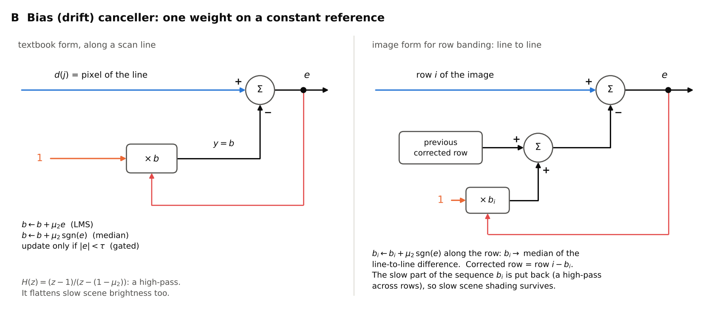
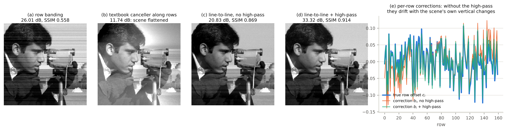
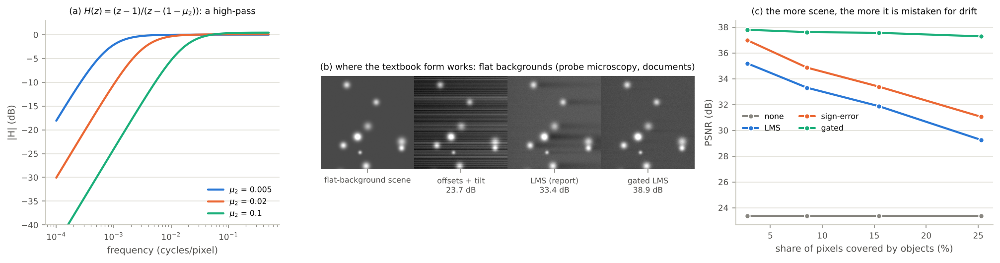

# B. Bias (drift) canceller: one weight on a constant reference

[back to README](../README.md) · [principle](0_principle.md)

## Idea

A slowly varying offset, such as baseline wander, sensor drift or a DC bias, is "interference" whose reference
is simply the constant 1. One adaptive weight $b$ multiplies it, the output is $e = d - b$, and LMS gives

$$b(n+1) = b(n) + \mu_2\, e(n), \qquad H(z) = \frac{z - 1}{z - (1 - \mu_2)}.$$

That is a first-order high-pass with a zero at DC and a corner near $\mu_2$ rad/sample. $b$ tracks the drift
with a time constant of about $1/\mu_2$ samples. In a larger canceller the same weight is the **bias weight**
that absorbs any DC difference between primary and reference.

## Why images are hard for it

A high-pass cannot tell a drifting offset from slow scene brightness: both are "slow". Run along the scan lines
of a natural image, the textbook canceller removes the sky-to-ground brightness along with the drift
(panel b below: 11.74 dB from 26.01 dB). The remedies split into two cases.

**Flat-background scenes** (probe microscopy, documents, astronomical frames, fluorescence) have a background
level that holds for most of each line. There the canceller works, provided the update ignores the objects:

* **sign-error update** $b \leftarrow b + \mu_2\,\mathrm{sgn}(e)$: $b$ converges to the running *median*
  instead of the mean, so a minority of object pixels does not pull it;
* **gated update**: the step is taken only when $|e| < \tau$, i.e. on pixels that look like background.

**Natural images with row banding.** The offset is constant along a row and changes from row to row, while
neighbouring rows of the scene are nearly identical. The bias weight therefore runs *line to line*. For row $i$
the primary is the row and the reference is the previous, already corrected row (plus the constant 1 for the
bias weight). The weight $b_i$ adapts along the row on $e = (\text{row}_i - \text{row}_{i-1}^{corr}) - b_i$ with a
sign-error update, so it converges to the median line-to-line difference, and the corrected row is
$\text{row}_i - b_i$. Since the previous row is already corrected, $b_i$ is the full offset of row $i$. It also
picks up the scene's own median change from row to row, and those errors accumulate. They are slow, while white
row banding is fast, so the slow part of the sequence $b_i$ is put back (Gaussian, 16 rows). Only fast banding
is removed, and slow scene shading survives.

## Implementation

| | Python | MATLAB |
|---|---|---|
| textbook form, along rows | `scenario_b.bias_canceller(img, mu2, update="lms"/"sign"/"gated", tau)` | `bias_canceller(...)` |
| line-to-line form | `scenario_b.interline_canceller(img, mu2=0.001, passes=2, hp_rows=16)` | `interline_canceller(...)` |
| flat-background test scene | `scenario_b.afm_scene(...)` | `afm_scene(H, W, n_obj, seed)` |
| theory | `scenario_b.bias_response_theory(mu2, omega)` | - |

## Results

**Row banding on the test image** (offset per row with standard deviation 0.05, plus read noise 0.01):

| | PSNR (dB) | SSIM |
|---|---|---|
| noisy | 26.01 | 0.558 |
| textbook canceller along rows | 11.74 | - |
| line to line, no high-pass | 20.83 | 0.869 |
| line to line + high-pass across rows | **33.32** | **0.914** |
| scenario F with the optical-black reference | 39.76 | 0.943 |

Without the high-pass the banding disappears (SSIM 0.869), but the per-row corrections drift with the scene's
own vertical changes (panel e), and PSNR falls below the input. With it, B gains 7.3 dB with no reference. F
gains 6.4 dB more, because it measures the offsets instead of inferring them.

**Flat-background scene** (blobs on a flat background, with row offsets and a linear drift along the scan):

* Panel a: the high-pass for three step sizes.
* Panel b: on such a scene the textbook LMS canceller works, raising PSNR from 23.7 dB to 33.4 dB. The gated
  update reaches 38.9 dB because the blobs no longer pull the weight; LMS leaves a dark "shadow" behind every
  object.
* Panel c: as more of the line is covered by objects, LMS and sign-error lose 6 dB, while the gated update
  stays flat.

## Design rules

1. Along scan lines, use B only when the background holds for most of each line, and always with a robust update
   (gated or sign-error).
2. For row banding on natural images, use the line-to-line form with a sign-error update and $\mu_2 \approx 10^{-3}$.
   Starting from $b_i = 0$, it needs about $|\Delta c|/\mu_2$ samples to converge (70 here), and two sweeps of a
   512-pixel row leave ample margin.
3. Set the high-pass across rows to the slowest banding you want removed. Slower offsets are indistinguishable
   from scene shading without a reference.

## Limits

* Low-frequency banding (1/f drift across rows) cannot be separated from scene shading by any reference-free
  method; it needs scenario F.
* On images whose PSNR is already high, B's small random-walk errors cost more than they remove (-1.8 dB on
  pixel RTS noise in the benchmark): use it only where banding is visible.
