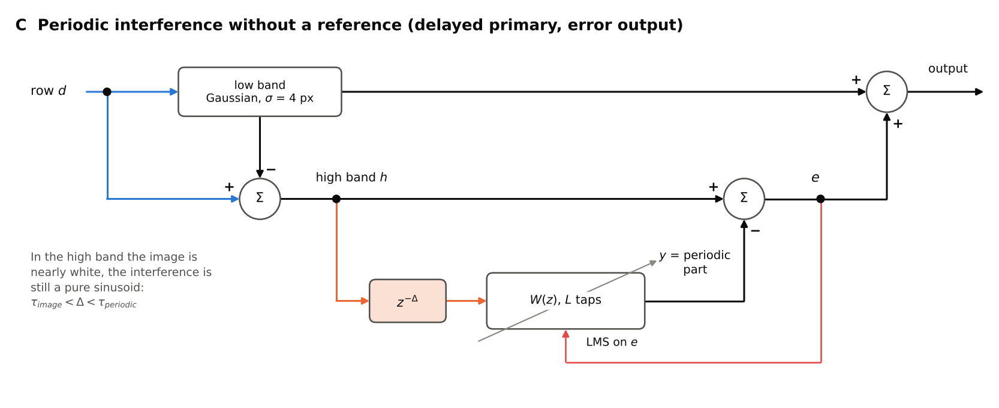
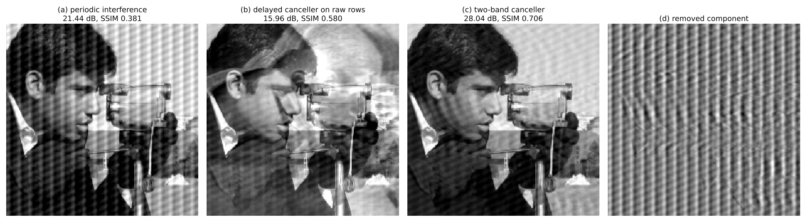
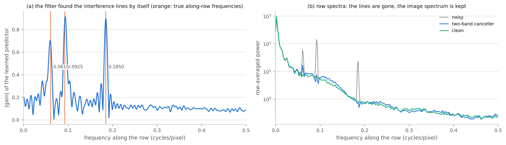
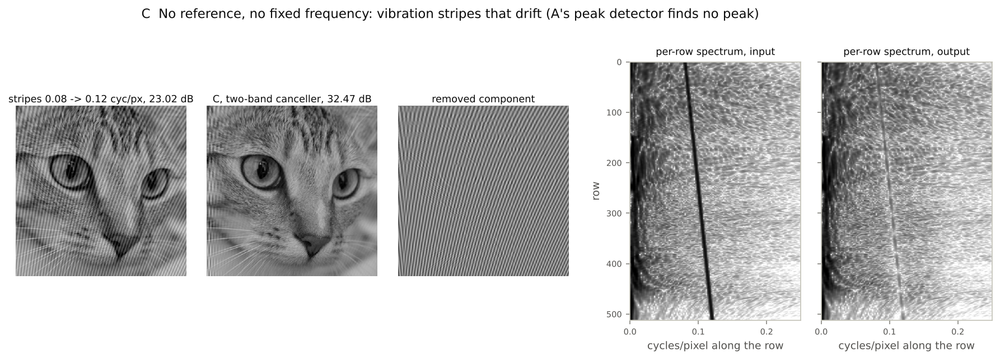
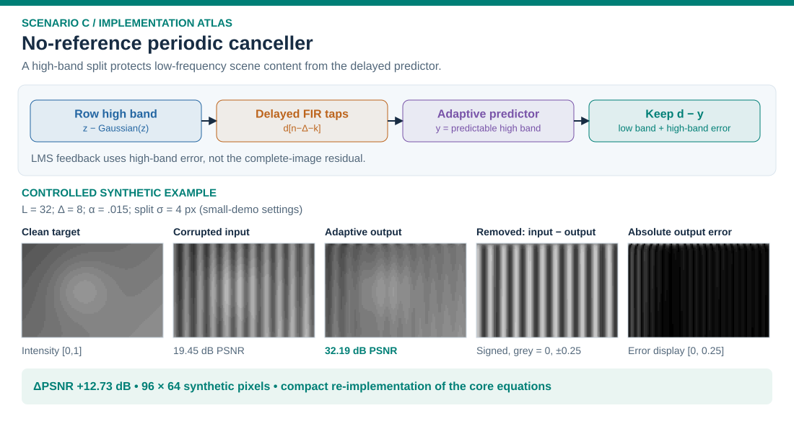

# C. Cancelling periodic interference without a reference

[back to README](../README.md) · [principle](0_principle.md)

<p align="center"></p>

## Idea

Scenario A needs the interference frequency. When it is unknown and there is no reference sensor, the primary
can serve as its own reference after a delay:

$$x(n) = d(n - \Delta), \qquad y(n) = \sum_{k=0}^{L-1} w_k\, x(n-k), \qquad e(n) = d(n) - y(n)\ \ (\text{output}).$$

A periodic component stays correlated at any delay, so the filter can predict it from the delayed samples. A
broadband component is decorrelated after $\Delta$ samples, so it cannot be predicted and passes to the
output. The condition is $\tau_{broadband} < \Delta < \tau_{periodic}$. The filter finds the interference lines
by itself: its frequency response converges to a set of band-passes at the interference frequencies, and it
does not depend on their phase.

## Why raw image rows break it

In an image the "broadband" part, the scene, is not broadband: neighbouring pixels are strongly correlated, and
large uniform regions are predictable over any delay a 512-pixel row allows. Run on raw rows, the canceller
predicts and cancels much of the image together with the stripes. Panel b below shows the result: 15.96 dB from
21.44 dB. No delay fixes this, because the image's correlation time is as long as the interference's.

## The fix: run it where the image is white

Split each row into two bands with a Gaussian of $\sigma = 4$ px:

* the **low band** holds most of the image and is passed through untouched;
* the **high band** holds edges and texture, which are close to white, while interference above about 0.05
  cycles/pixel passes almost unchanged and is still a pure sinusoid.

Run the delayed canceller on the high band ($L = 128$, $\Delta = 8$, normalised step $\alpha = 0.002$, weights
carried from row to row), and add its error output back to the low band. In the high band the delay condition
holds, and the low band never sees the canceller.

## Implementation

| | Python | MATLAB |
|---|---|---|
| two-band canceller | `scenario_c.subband_canceller(img, L=128, delay=8, alpha=0.002, split_sigma=4)` | `subband_canceller(...)` |
| canceller on raw rows (fails, for comparison) | `scenario_c.delayed_canceller(img, L=32, delay=64)` | `delayed_canceller(...)` |
| learned predictor's response | `scenario_c.predictor_response(w, delay)` | (in `demo_scenarios.m`) |

## Results

Same interference as in scenario A: stripes, their harmonic and a diagonal moire.



| | PSNR (dB) | SSIM |
|---|---|---|
| noisy | 21.44 | 0.381 |
| delayed canceller on raw rows | 15.96 | 0.580 |
| two-band canceller, no reference, no frequency | **28.04** | **0.706** |
| scenario A, detected frequencies | 41.56 | 0.980 |



Panel a shows the learned predictor after the last row: sharp peaks at exactly the three along-row
frequencies, 0.061, 0.0925 and 0.185 cycles/pixel, found without being told. Panel b shows the row spectra: the
lines are gone, and the image spectrum around them is kept.

## Why C stays well below A

* **The line enhancer inside has a gain below one.** The predictor passes each line with gain
  $G = (L/2)\,\mathrm{SNR}/((L/2)\,\mathrm{SNR}+1)$ (scenario E), and in the high band the stripes are weak
  compared with the image texture. A fraction $1-G$ of each line survives, visible as faint stripes in panel c.
* **The low band is not cancelled.** A component below about 0.05 cycles/pixel falls partly into the low band.
* **The image's high band is not perfectly white.** Strong edges give the filter something else to predict
  (panel d shows a little image structure among the removed stripes).

A is the method of choice when the frequency can be known or detected. C is the fallback when the interference
changes too much for a fixed reference, or as a detector: the peaks of its learned response are the
frequencies to hand to A.

## Design rules

1. Split at a scale that puts the interference well inside the high band: Gaussian $\sigma \approx 1/(2\pi f_{min})$
   or less, with $f_{min}$ the lowest interference frequency of interest.
2. Choose $\Delta$ larger than the high band's correlation (a few pixels) and $L$ long: the line gain $G$
   grows with $L$.
3. Keep $\alpha$ small (about $2\cdot10^{-3}$): the weights see the whole image, row after row, and the
   interference is stationary.

## Try it

```python
from adaptive_denoise import noise, scenario_c
from adaptive_denoise.imageio import load_test_image
from adaptive_denoise.metrics import psnr

x, _ = load_test_image()
nz = noise.make("periodic", x)
out, info = scenario_c.subband_canceller(nz.y, record=True)     # no frequency, no reference
print(f"{psnr(x, nz.y):.2f} dB -> {psnr(x, out):.2f} dB")        # 21.44 dB -> 28.04 dB
f, H = scenario_c.predictor_response(info["weights"], 8)        # the band-pass the predictor learned
```

```matlab
x = load_test_image();
nz = make_noisy('periodic', x);
[out, info] = subband_canceller(nz.y);                  % L = 128, delay 8, alpha 0.002, split sigma 4
fprintf('%.2f dB -> %.2f dB\n', psnr_db(x, nz.y), psnr_db(x, out));
```

## Application example: stripes that drift



Vibration stripes whose frequency drifts from 0.08 to 0.12 cycles/pixel down the image. The spectrum has no
sharp peak, so A's detector finds nothing. C needs neither a frequency nor a reference: its weights, carried
from row to row, follow the drift, and the per-row spectra show the line removed from top to bottom. 23.02 to
32.47 dB. Details in [examples](examples.md#c-vibration-stripes-whose-frequency-drifts).

## Implementation atlas: controlled image example



**Worked interpretation.** Construct h = z − Gaussian(z) on the row-centred signal, and predict h from delayed taps. The LMS error is h − y, while the image output is d − y. The Gaussian split protects the low band but not all scene edges or textures. In the supplemental synthetic example the shorter FIR and larger normalised step are chosen for its smaller raster.

Settings and PSNR are printed in the panel. More worked examples: [implementation atlas](implementation_atlas.md#2-the-six-scenarios-in-images).
