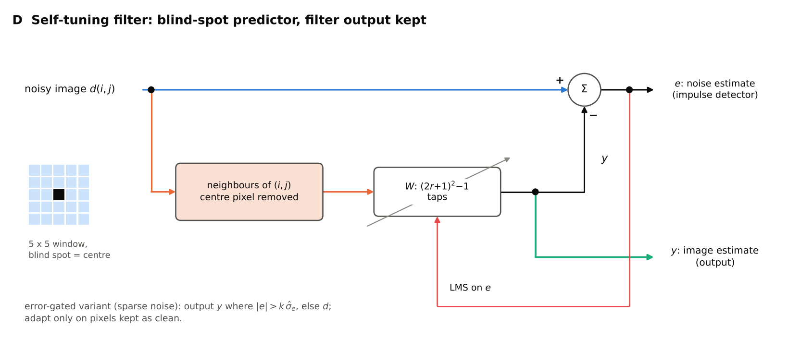
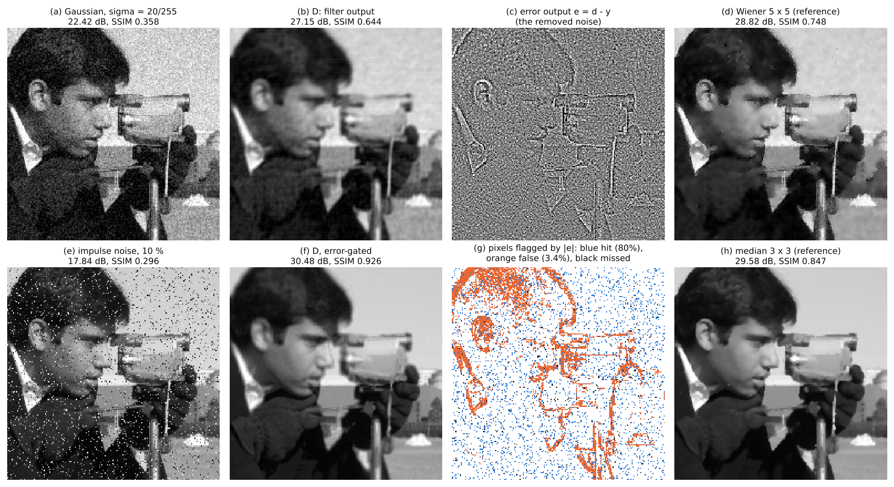
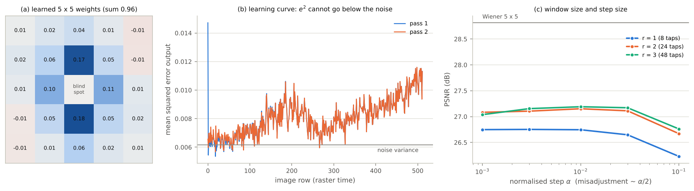

# D. Adaptive self-tuning filter: the blind-spot predictor

[back to README](../README.md) · [principle](0_principle.md)

## Idea

The wiring of scenario C, with the other output. The primary, delayed, is the reference, and the **filter
output** $y$ is kept. The filter can reproduce only what is predictable across the delay. When the wanted
signal is the predictable part and the noise is broadband, $y$ is the cleaned signal. The filter tunes itself to
the signal's spectrum without being told where the signal is, hence "self-tuning".

## Image form: a blind spot instead of a delay

In an image the delay becomes a **blind spot**. Pixel $(i,j)$ is predicted from its $(2r+1)\times(2r+1)$
neighbourhood with the centre pixel left out:

$$y(i,j) = \sum_{(a,b) \neq (0,0)} w_{ab}\, d(i+a, j+b), \qquad e(i,j) = d(i,j) - y(i,j).$$

White noise in the centre pixel is uncorrelated with every tap, so it cannot be predicted. The image is
correlated with its neighbours, so it can be. Minimising $E[e^2]$ is therefore the same as minimising the error
of the prediction against the clean image, without ever seeing the clean image. The weights adapt with LMS in
raster order and follow the local statistics as the scan moves across the image.

Two outputs, two uses:

* **filter output $y$**: the image estimate, for broadband noise (Gaussian, Poisson);
* **error output $e$**: the noise estimate. For **sparse** noise it is a detector: small on clean pixels,
  large on impulses.

## The error-gated variant for sparse noise

Impulses break plain LMS twice over. They enter the taps, which spoils the prediction of their neighbours, and
they enter the error, which throws the weights. The gated version turns the error output into a switch:

1. flag $(i,j)$ when $|e| > k\,\hat\sigma_e$, with $\hat\sigma_e$ a running robust scale of the error (k = 4);
2. output $y$ on flagged pixels and the untouched $d$ on clean ones;
3. adapt only on clean pixels;
4. on the next pass, take the taps from the previous output, so flagged neighbours no longer spoil the
   prediction. This matters for bursts, whose neighbours along the row are corrupted too.

Clean pixels are passed through unchanged. That is the advantage over any smoothing filter, and the reason this
variant beats the 3 x 3 median on random-valued impulses and on bursts.

## Implementation

| | Python | MATLAB |
|---|---|---|
| self-tuning filter | `scenario_d.self_tuning(img, r=2, alpha=0.01, passes=2)` | `self_tuning(img, r, alpha, passes)` |
| error-gated | `scenario_d.self_tuning_gated(img, r=2, alpha=0.01, k=4, passes=3)` | `self_tuning_gated(...)` |
| the predictor | `predictor.blindspot_lms(img, r, hole, alpha, mu2, passes, update)` | `blindspot_lms(...)` |

Defaults: a 5 x 5 window (24 taps), normalised step $\alpha = 0.01$ (misadjustment about 0.5 %), two raster
passes, image mean removed.

## Results

| noise | noisy | D | D gated | median 3 x 3 | adaptive median | Wiener 5 x 5 |
|---|---|---|---|---|---|---|
| Gaussian, $\sigma$ = 20/255 | 22.42 | 27.15 | - | 26.95 | 24.68 | **28.82** |
| Poisson, peak 60 | 20.97 | **26.83** | - | 26.10 | 23.61 | 24.76 |
| random-valued impulses, 10 % | 17.84 | 24.42 | **30.48** | 29.58 | 25.18 | 17.96 |
| bursts of impulses | 23.68 | 25.81 | **30.67** | 30.08 | 27.77 | 23.68 |
| salt and pepper, 10 % | 14.85 | 23.34 | 31.54 | 29.50 | **33.16** | 14.91 |

(PSNR in dB. Wiener 5 x 5 uses the noise level estimated from the image.)

* **Gaussian noise:** +4.7 dB. D trails a local Wiener filter by 1.7 dB. The Wiener filter adapts its
  smoothing to the local variance at every pixel; the predictor carries one set of weights through the scan
  and can only follow slowly.
* **Poisson noise:** D beats both. A single global noise level does not fit signal-dependent noise, while the
  predictor never needs one.
* **Impulses:** the gated predictor flags 80 % of the impulses with 3.4 % false alarms, mostly on edges and
  hair (panel g). Replacing only those pixels gives 30.48 dB and SSIM 0.926, against 0.847 for the median.
* **Salt and pepper:** the adaptive median wins because those pixels sit at exactly 0 or 1, a give-away the
  generic error detector does not use.

* **Panel a:** the learned weights sum to 0.96 and concentrate on the four nearest neighbours. This is a
  smoothing kernel that the data chose.
* **Panel b:** the learning curve converges within the first rows. The error never falls below the noise
  variance, which is exactly the part the blind spot makes unpredictable. Rows with more texture have a
  larger prediction error.
* **Panel c:** 24 or 48 taps are better than 8. Over a wide range of steps (0.003 to 0.03) the result changes
  by less than 0.1 dB.

## Limits

* D needs **pixel-wise independent noise**. With correlated noise, the neighbours predict the noise too, and D
  loses 0.4 dB. The blind spot must then grow, which is scenario E.
* Structured interference (stripes, banding, readout telegraph) is predictable from the neighbours and is kept.
  Those cases belong to A, B, C and F.
* Pixel RTS noise in a single frame is too weak and too similar to texture to be flagged reliably. Over a frame
  sequence, each pixel's switching history would serve as the reference.
