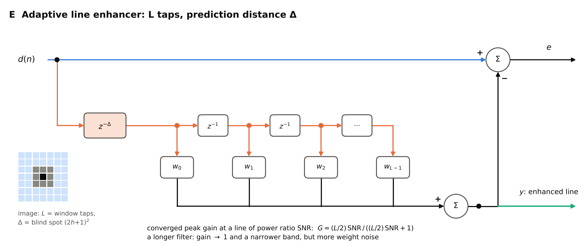
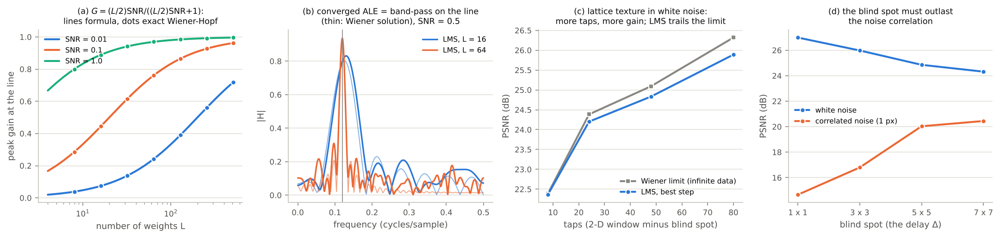
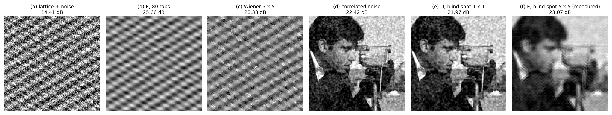

# E. Adaptive line enhancer: the quantitative form of scenario D

[back to README](../README.md) · [principle](0_principle.md)

## Idea

The adaptive line enhancer (ALE) is the self-tuning filter written with a tapped delay line: $L$ weights fed with
the input delayed by the prediction distance $\Delta$,

$$y(n) = \sum_{k=0}^{L-1} w_k\, d(n - \Delta - k).$$

It enhances spectral lines in broadband noise with no prior knowledge of their frequencies, and it follows a
line whose frequency drifts.

## Converged filter

For a sinusoid of power $P$ in white noise of power $\sigma^2$, with $\mathrm{SNR} = P/\sigma^2$, the
Wiener–Hopf solution $\mathbf R\mathbf w = \mathbf p$ is a band-pass centred on the line. Its gain at the line
frequency is

$$G = \frac{(L/2)\,\mathrm{SNR}}{(L/2)\,\mathrm{SNR} + 1}.$$

With several lines, the filter is a sum of such band-passes, one at each $\pm\omega_n$, each with its own gain.

* $G \to 1$ as $L \to \infty$: a longer filter passes the line with less loss, and its passband narrows
  (about $2\pi/L$), letting in less noise.
* A longer filter adapts more slowly and carries more weight noise: the misadjustment grows with
  $L\,\mu_2\,\sigma_x^2$.
* $\Delta$ must exceed the correlation time of the noise. $\Delta = 1$ is enough for white noise.

The formula is checked against the exact Toeplitz solution in panel a below. For a line on a DFT bin it agrees
to four decimals for $L$ from 8 to 512 and SNR from 0.008 to 2. Off-bin, the deviation stays below 0.004.

## Image form

In 2-D, the taps are the $(2r+1)^2$ window minus the blind spot, and the delay $\Delta$ is the size of the blind
spot, $(2h+1)^2$. The ALE's two rules carry over directly:

* **more taps, more gain** on periodic or strongly correlated image content;
* **the blind spot must outlast the noise correlation.** When the noise is correlated over a pixel or two, the
  neighbours predict the noise as well as the image, and a single-pixel blind spot (scenario D) keeps the
  noise. `line_enhancer` therefore measures the noise correlation in the flattest 16 x 16 tiles of the image
  (`predictor.noise_correlation`). It picks the blind spot as the largest lag with correlation above 0.2
  (`predictor.choose_hole`) and keeps at least two rings of taps around it.

## Implementation

| | Python | MATLAB |
|---|---|---|
| 2-D line enhancer | `scenario_e.line_enhancer(img, r=3, hole=None, alpha=0.01)` | `[y, hole] = line_enhancer(img)` |
| noise correlation / blind spot | `predictor.noise_correlation(img)`, `predictor.choose_hole(img)` | `noise_correlation`, `choose_hole` |
| 1-D ALE (LMS) | `scenario_e.ale_lms(d, L, delay, mu2)` | `ale_lms(d, L, delay, mu2)` |
| exact weights, gain, response | `ale_wiener_weights`, `ale_peak_gain`, `ale_response` | same names |
| 2-D Wiener limit | `scenario_e.wiener_limit_2d(components, sigma, r, hole)` | - |

## Results

* **Panel a:** the peak-gain formula (lines) against the exact Wiener–Hopf solution (dots).
* **Panel b:** an LMS-trained ALE on a sinusoid in noise (SNR 0.5). The converged filter is a band-pass on the
  line, narrower for $L = 64$ than for $L = 16$, close to the Wiener solution (thin lines). The ripple outside
  the band is weight noise, and there is more of it for $L = 64$.
* **Panel c:** a two-wave lattice texture in white noise ($\sigma = 0.2$). PSNR rises with the number of taps,
  and LMS stays within about half a decibel of the infinite-data Wiener limit up to 80 taps.
* **Panel d:** the blind spot. For white noise the smallest one is best (27.0 dB with 1 x 1, 24.3 dB with
  7 x 7, because each step removes useful taps). For noise correlated over one pixel the order reverses:
  14.7 dB with 1 x 1, 20.0 dB with 5 x 5, and 20.4 dB with 7 x 7.

| | PSNR (dB) |
|---|---|
| lattice texture + noise $\sigma$ = 0.2 | 14.41 |
| E, 80 taps | **25.66** |
| Wiener 5 x 5 | 20.38 |
| correlated noise on the test image | 22.42 |
| D, blind spot 1 x 1 | 21.97 |
| E, blind spot 5 x 5 (chosen from the measured correlation) | **23.07** |
| median 3 x 3 | 23.33 |

On periodic or quasi-periodic texture, the line enhancer is in its element: 5.3 dB above a local Wiener filter.
On the natural image with correlated noise, choosing the blind spot from the data turns D's loss into a gain,
but local filters all struggle there: correlated noise overlaps the image spectrum.

## Design rules

1. Blind spot: the noise correlation length, measured on flat regions.
2. Window: as large as the structure stays stationary. A larger window adds gain on regular texture and
   costs adaptation speed on varying content.
3. Step: normalised $\alpha \approx 0.01$ for natural images. Regular textures allow a much smaller step and
   more passes.

## Limits

* On structured interference (banding, stripes, readout telegraph), the measured correlation is long. A large
  blind spot then smooths the image and keeps the interference (-1.3 to -4.0 dB in the benchmark). Those
  cases belong to A, B, C and F.
