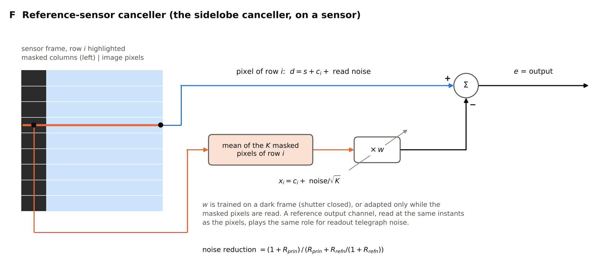
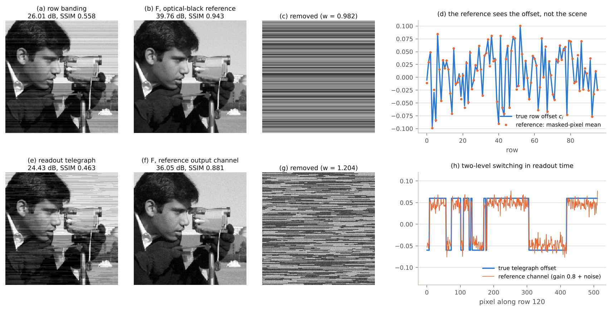
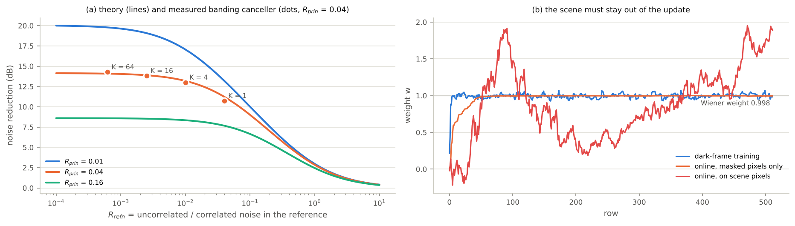
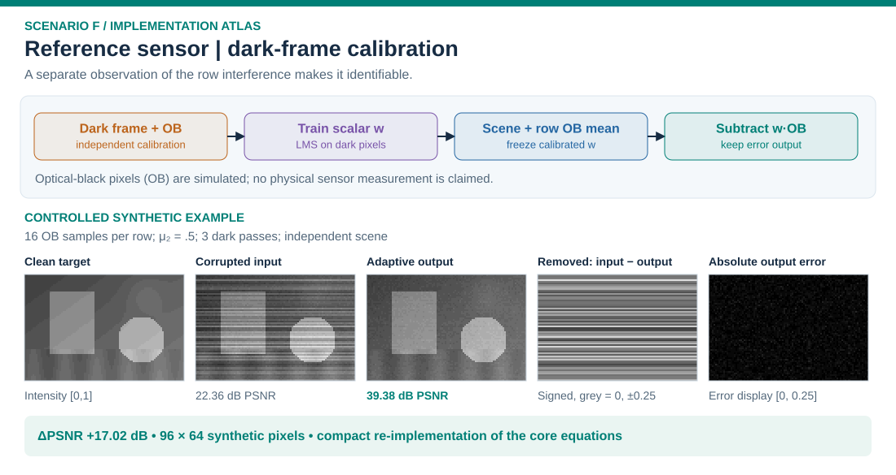
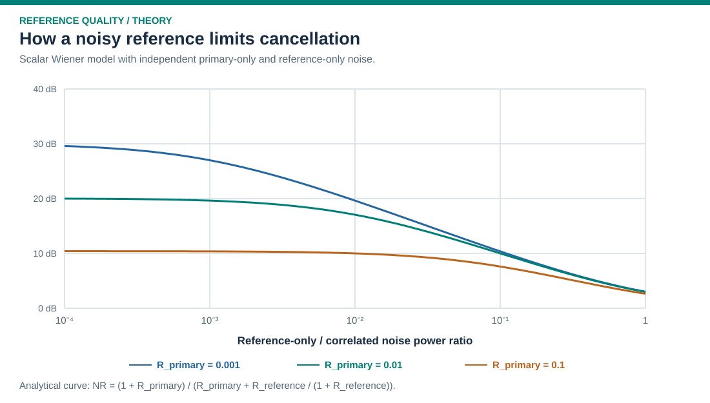

# F. Reference-sensor canceller: the sidelobe canceller, on an image sensor

[back to README](../README.md) · [principle](0_principle.md)

## Idea

In an antenna array, a strong interferer entering through the sidelobes of the main beam is cancelled with an
auxiliary element steered at the interferer. That element receives the interference, but almost none of the
wanted signal, and the canceller filters it and subtracts it from the main channel. This is the canceller in its
purest form: a genuine reference, uncorrelated with the signal. For a few discrete interferers it is much
simpler than adapting the whole beam.

## Image form: sensors already carry such references

* **Optical-black (masked) columns.** Most image sensors read a few columns covered with metal at the edge of
  every row. They see the row's offset (row banding, from shared row circuitry) but no light, which makes them
  a perfect reference for banding. The reference for row $i$ is the mean of its $K$ masked pixels,
  $x_i = c_i + \text{noise}/\sqrt K$, and the canceller subtracts $w\,x_i$ from every pixel of the row.
* **A reference output channel.** Detectors with a shared output amplifier can digitise a reference output at
  the same instants as the pixels. It sees the amplifier's two-level telegraph (popcorn) switching, which draws
  horizontal streaks in the image, but none of the scene. The canceller filters it, $y(n) = \mathbf w^T\mathbf x(n)$,
  and subtracts it in raster order.
* The same structure covers **external pickup coils** in low-field MRI, which see electromagnetic interference
  but not the patient, and **dark frames** in general.

## Training: keep the scene out of the update

The theory assumes the canceller converges to the Wiener weight. In an image, the scene enters the primary as
the "signal" $s$. It is uncorrelated with the reference, so it does not bias the weights, but it is far
stronger than the interference, so it dominates the LMS gradient noise (the minimum MSE includes $E[s^2]$; see
the principle page, section 4). For banding it is worse: the reference is one number per row, so the scene's
row means act directly as noise in the update. Three options:

1. **Dark-frame training (default).** Adapt on a frame with the shutter closed, then freeze the weights. Only
   read noise competes, and the weights settle fast and accurately.
2. **Gate the update to the masked pixels.** During readout, adapt only while the optical-black pixels are read,
   each predicted from the mean of the others in its row.
3. **Online on the scene**, for comparison. This needs a very small step, and for banding it wanders (panel b
   below).

## Theory

With uncorrelated noise in both inputs, the converged canceller reduces the noise power by

$$\mathrm{NR} = \frac{1 + R_{prin}}{R_{prin} + R_{refn}/(1+R_{refn})},$$

with $R_{prin}$ the ratio of uncorrelated (read) noise to correlated noise (the interference) in the primary,
and $R_{refn}$ the same ratio in the reference. For banding, $R_{prin} = \sigma^2/\sigma_{row}^2$ and
$R_{refn} = (\sigma^2/K)/\sigma_{row}^2$. The Wiener weight is $1/(1+R_{refn})$ for banding, and
$g\,\sigma_t^2/(g^2\sigma_t^2 + \sigma_r^2)$ for a reference channel of gain $g$.

## Implementation

| | Python | MATLAB |
|---|---|---|
| train on a dark frame | `scenario_f.train_row_weight(dark, dark_ob)` | `train_row_weight(dark, dark_ob)` |
| banding canceller | `scenario_f.row_reference_canceller(y, ob, w)` | `row_reference_canceller(y, ob, w)` |
| online variants | `scenario_f.row_reference_online(y, ob, mu2, mode="ob_gated"/"scene")` | `row_reference_online(...)` |
| reference output channel | `scenario_f.channel_reference_canceller(y, ref, L=1, train=(dark, dark_ref))` | `channel_reference_canceller(y, ref, L, alpha, dark, dark_ref)` |
| theory | `scenario_f.noise_reduction_theory(R_prin, R_refn)` | `noise_reduction_theory(...)` |

The noise models `banding` and `telegraph_readout` return the references (`side["ob"]`, `side["ref_out"]`) and a
dark frame with its own references (`side["dark"]`, `side["dark_ob"]`, `side["dark_ref"]`).

## Results

| | noisy | F | theory | best other |
|---|---|---|---|---|
| row banding ($\sigma_{row}$ = 0.05, read noise 0.01, K = 16) | 26.01 | **39.76** | 39.90 | 33.32 (B) |
| readout telegraph ($\pm$0.06, reference gain 0.8, noise 0.01) | 24.43 | **36.05** | 36.13 | 24.85 (Wiener 5 x 5) |

(PSNR in dB. "Theory" is the noisy PSNR plus the predicted NR.)

The learned weights match the Wiener values: 0.982 for banding (Wiener 0.998) and 1.204 for the telegraph
channel (Wiener 1.198, close to 1/0.8 shrunk by the reference noise). Readout telegraph noise is the clearest
case for a reference: without one, no other method in the benchmark gains more than 0.4 dB.

* **Panel a:** the noise reduction predicted by the two-input theory (lines) and measured on banding with
  $K$ = 1, 4, 16 and 64 masked pixels per row (dots, mean of three draws). Averaging more masked pixels lowers
  $R_{refn}$ and climbs the curve toward the ceiling $1 + 1/R_{prin}$ set by the read noise.
* **Panel b:** the weight during training. On a dark frame it settles within a few rows. Adapted only on masked
  pixels, it settles within about 50 rows. Adapted on scene pixels, it wanders between 0 and 2 for the whole frame,
  driven by the scene's row means.

## Design rules

1. Average as many masked pixels per row as the sensor offers: the gain follows the theory curve in $R_{refn}$.
2. Train on dark frames, or gate the update to the reference pixels. Never adapt a row-wise reference on scene
   pixels.
3. With a reference channel that is filtered differently from the primary, use more taps ($L > 1$), so the
   filter can learn the transfer function between them.

## Implementation atlas: controlled image example

**Worked interpretation.** If the optical-black row mean is 0.075 and the calibrated scalar weight is 0.96, subtract 0.072 from every pixel in that row. Reference calibration should remain independent of the scene. The numerical images and dark frames in the stored repository are simulated sensor observations, not physical measurements. Misalignment or reference leakage can invalidate the ideal cancellation limit.

The independent illustration uses the parameters printed in the figure; it is not a rerun of the original benchmark. See [worked examples](implementation_atlas.md#2-the-six-scenarios-in-images) and [evaluation protocol](evaluation_protocol.md).

