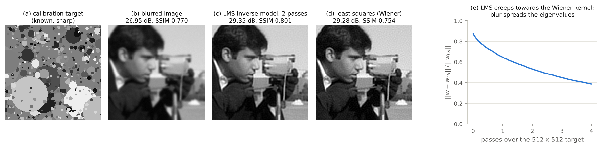

# Beyond the six scenarios: blur, by adaptive inverse modelling

[back to README](../README.md) · [principle](0_principle.md)

Blur is a convolution, $y = h * x + n$, not an additive interference. In the benchmark every one of the six
scenarios leaves a blurred image as it is or makes it slightly worse (-0.8 to 0 dB). The LMS machinery still
applies, wired differently.

## Inverse modelling

Show the imaging system a **calibration target** whose sharp version $t$ is known. Feed the blurred target
$h * t + n$ to the adaptive filter, and use the sharp target as the desired signal:

$$e(i,j) = t(i,j) - \sum_{a,b} w_{ab}\,(h*t + n)(i+a, j+b).$$

By the canceller's own theory, the converged filter is $W = S_{xd}/S_{xx}$. Without noise this is the inverse
$1/H$ of the blur. With noise in the blurred input it becomes the **Wiener deconvolution filter**
$H^*S_{tt}/(|H|^2S_{tt} + S_{nn})$, which stops boosting frequencies where noise dominates. The learned
$9\times 9$ kernel is then applied to the blurred image.

The target (`inverse_model.dead_leaves`) is a pattern of overlapping discs with power-law radii. Its spectrum
falls off like a natural image's, so the learned filter balances sharpening against noise as a natural image
needs.

## Results

| | PSNR (dB) | SSIM |
|---|---|---|
| blurred (PSF $\sigma$ = 1.6 px) + noise 0.005 | 26.95 | 0.770 |
| LMS inverse model, 2 passes over the target | **29.35** | **0.801** |
| least-squares kernel (what LMS converges to) | 29.28 | 0.754 |

Panel e shows the eigenvalue spread at work. Blur makes the input correlation matrix nearly singular at high
frequencies, so LMS creeps toward the least-squares kernel: after four passes over a 512 x 512 target it is
still 39 % away. Stopping early acts as regularisation. The two-pass kernel boosts the highest frequencies less
than the least-squares one, so it gives the better SSIM on the test image.

| | Python | MATLAB |
|---|---|---|
| target | `inverse_model.dead_leaves()` | `dead_leaves(H, W)` |
| LMS training | `inverse_model.train_inverse_filter(sharp, blurred, r=4, alpha=0.02, passes=2)` | `train_inverse_filter(...)` |
| closed form | `inverse_model.least_squares_inverse_filter(sharp, blurred, r=4)` | - |
| apply | `inverse_model.apply_filter(img, kernel)` | `apply_filter(img, kernel)` |

In the all-noise cascade, deblurring after denoising lowers PSNR. The kernel amplifies the residual noise more
than it restores detail, so `pipeline.cascade` leaves it off by default (`deblur=True` turns it on).
