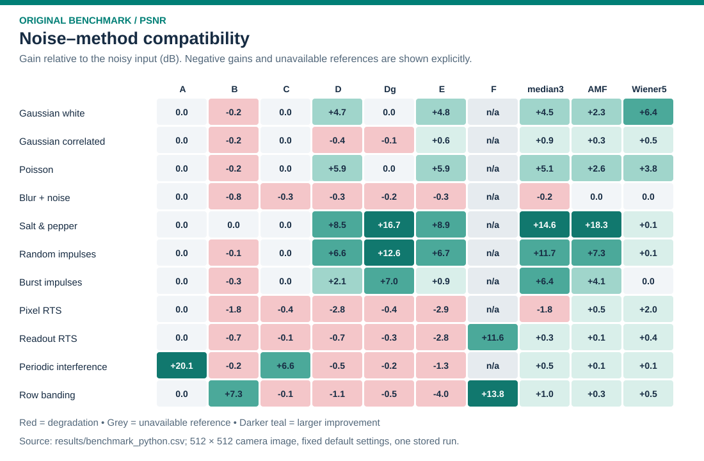

# Evaluation protocol and interpretation

[Back to repository](../README.md) · [Implementation atlas](implementation_atlas.md)

## Evidence layers

| Layer | Source | Interpretation |
|---|---|---|
| Original image benchmark | [CSV](../results/benchmark_python.csv), [PSNR table](../results/benchmark_python.md) | One stored 512 × 512 camera-image run with fixed defaults and simulated corruptions |
| Original scenario demonstrations | [Results gallery](../figures/results/) and per-scenario docs | Includes specialised AFM, lattice, inverse-filter, and theory examples; not all rows use the camera image |
| Supplemental atlas | [Synthetic scores](../results/atlas_synthetic.csv), [generator](../tools/build_atlas.cjs) | Independently computed reduced-size illustrations with disclosed settings; not additional camera-benchmark measurements |
| Extended examples | [Python script](../python/extended_examples.py) | Optional new runs using the original Python modules; outputs are generated locally, not part of the stored benchmark |
| Application examples | [Examples page](examples.md), [scores](../results/examples_python.csv), [generator](../python/make_examples.py) | One realistic corruption per scenario on a matching CC0 or public-domain image, with the best alternative on the same input |

The benchmark compares methods on the same corruption within each row. F is unavailable when the side channels it requires do not exist; `n/a` must not be treated as zero. The mixed-noise pipeline has both references and uses F twice. A detects spectral frequencies from the primary by default. The simulation's clean target, corruption masks and exact interference arrays are not used for ordinary scenario decisions; the clean target is available for scoring. F does use independent dark-frame calibration and synchronous reference data supplied by the simulated sensor.

## Metrics and reporting

All images are grayscale and nominally scaled to [0,1]. Let `s` be the clean target and `t = clip(restoration,0,1)`. For N pixels,

$$\mathrm{MSE}=\frac{1}{N}\sum_k(s_k-t_k)^2,\qquad
\mathrm{PSNR}=10\log_{10}(1/\mathrm{MSE}).$$

A gain of 3.01 dB corresponds to approximately half the MSE; a 10 dB gain corresponds to a tenfold reduction in MSE. This is a within-image comparison, not a percentage of visual quality. SSIM uses an 11 × 11 Gaussian window with σ = 1.5 and excludes the outer five-pixel border. Both metrics clip the estimate by default, so out-of-range reconstruction errors are not fully reflected; inspect unclipped values when assessing numerical stability. Offset-aligned PSNR in the flat-background B experiment is a separate convention, not directly comparable to unaligned PSNR.

The complete CSV includes per-noise SSIM and timing fields. The original Markdown table lists PSNR for single-noise rows and SSIM for cascade rows. Timing is a single software observation, not a hardware-throughput benchmark. Zero timing in cumulative stages is not a measured zero-cost operation. MATLAB uses independent random streams and writes a separate CSV; the committed Python numbers should not be represented as MATLAB measurements or bitwise equivalence.

## What the stored results support

* **Structured periodic interference:** A reaches 41.56 dB from 21.44 dB; C reaches 28.04 dB without a supplied sinusoidal reference. The method can remove genuine periodic scene texture if it is mistaken for interference.
* **Row banding:** F reaches 39.76 dB; B reaches 33.32 dB without optical-black information. This is an information-availability comparison rather than two methods operating with identical inputs.
* **Sparse interference:** D gated reaches 30.94 dB for random-valued impulses and 31.76 dB for bursts. Adaptive median remains stronger for exact salt-and-pepper corruption (33.16 against 32.23 dB). The gate threshold k = 4 suits densities up to about 10 %; [the density sweep](../results/gated_density_sweep.csv) shows k = 3 holding to 25 %.
* **Broadband noise:** D/E are competitive in several rows; local Wiener is stronger for white Gaussian noise, and the median is slightly stronger for correlated Gaussian noise. E's strength is retaining coherent texture, not universal superiority.
* **Blur:** the six denoisers do not invert a point-spread function. Adaptive inverse modelling is a separate calibration-based experiment.
* **Mixed corruption:** the fixed cascade increases PSNR by 9.95 dB and SSIM from approximately 0.177 to 0.686. This is a cumulative progression; it does not isolate the marginal effect of each module under all possible orderings.

These are synthetic corruption results on a controlled image, not a claim of generalisation to all scenes or an evaluation of physical sensors. No cross-image uncertainty interval or physical acquisition results are included in the committed benchmark.

## Practical limitations and validation checks

| Concern | Interpretation / suggested validation |
|---|---|
| Noise independence | The textbook cancellation identity needs scene–noise and scene–reference decorrelation. For adaptive finite-sample estimates this is approximate; inspect removed scene detail and residual spectra. |
| Blind-spot independence | Excluding the central tap helps for independent noise, but reflected boundaries, frame-level statistics and multiple passes can introduce dependencies. Do not describe the current code as strict J-invariant inference. |
| Correlation heuristic | E estimates correlation on low-variance detrended tiles and extends the hole through consecutive positive lags above the threshold. This is a heuristic, not a proof that every off-centre noise sample is independent. |
| Step-size stability | The conventional mean-convergence bound uses the regressor covariance and independence assumptions. Mean-square stability can impose stricter conditions. The contrast-normalised step is not per-sample NLMS. |
| Degenerate input | The existing variance-normalised paths assume nonzero variance and valid window sizes; use nonconstant images with sufficient dimensions (the default spectral block is 128 × 128). For a production API, explicitly validate shapes and guard zero variance. |
| Raster versus streaming | A/C update along rows; D/E require a symmetric neighbourhood and multiple passes, and F may use separate calibration. Do not infer real-time, causal or hardware latency from these software examples. |
| Reference purity | F assumes aligned dark/scene references observing the interference rather than the scene. Test reference leakage, delay, gain drift and dark calibration mismatch before deployment. |
| Reproducibility | For broader evaluation, freeze the parameter policy, report the input-image identity, use multiple images/seeds/noise levels, keep identical corruptions across compared methods, and report paired gains and uncertainty. |

## Suggested follow-on experiments

The original result files are intentionally preserved. Use a separate results directory for new comparisons. A rigorous expansion would use several grayscale scenes with flat areas, sharp edges and periodic textures; multiple strengths and seeds per noise type; matched-information comparisons (especially F); and stress tests for reference leakage and frequency mismatch. A separate validation suite could quantify residual noise power, edge preservation, impulse detection precision/recall and spectral attenuation. For the cascade, compare one-stage removals and alternative orders on paired corruptions, not just cumulative intermediate outputs.
