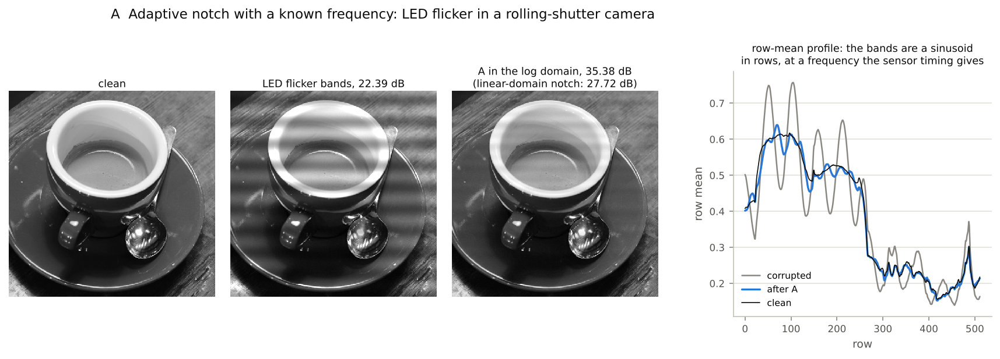
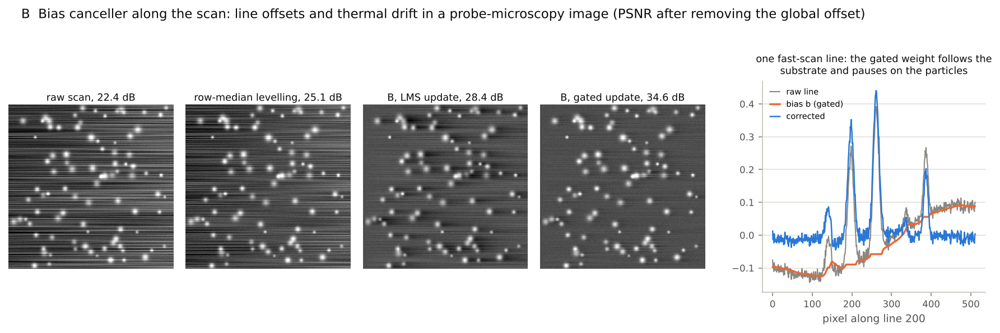
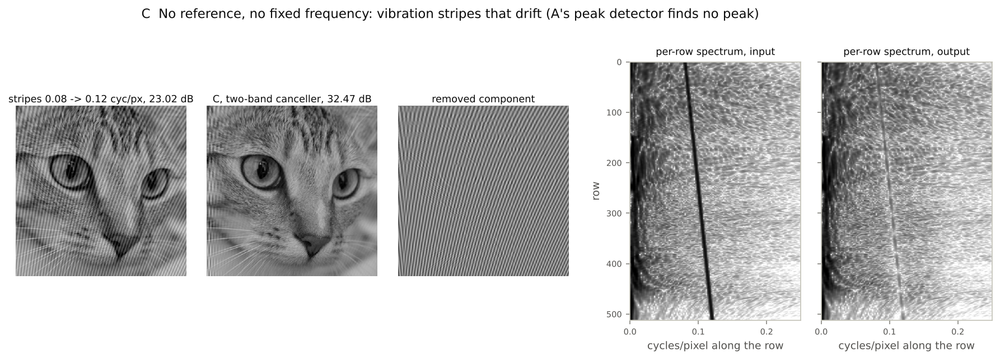
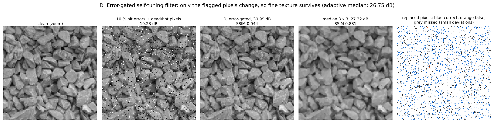
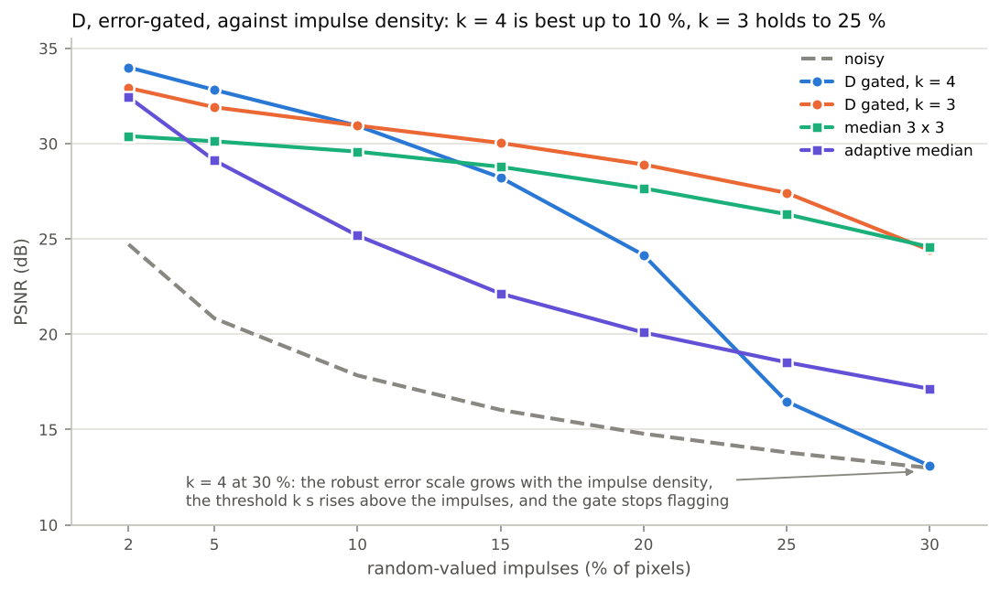
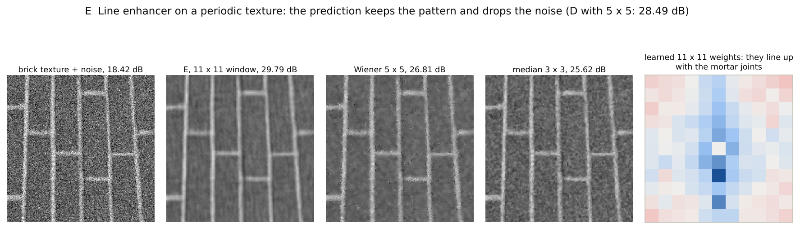
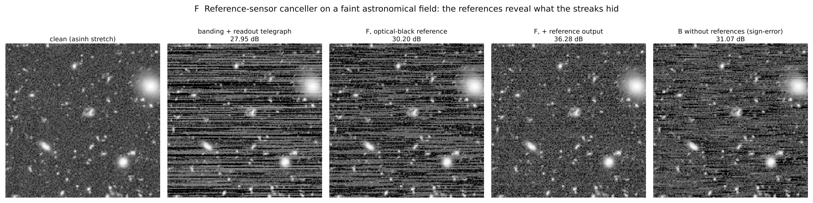

# Application examples

[back to README](../README.md) · [decision guide](../figures/diagrams/diagram_decision_guide.png) · [principle](0_principle.md)

The benchmark puts every corruption on one test image. This page gives each configuration the kind of
problem it was built for, on an image that suits it. Each example states what produces the interference,
where the reference comes from, the settings, and what the best alternative does on the same input.

| | Example | Image | Corruption | Noisy | Canceller | Best alternative |
|---|---|---|---|---|---|---|
| **A** | [LED flicker](#a-led-flicker-in-a-rolling-shutter-camera) | coffee | multiplicative bands, frequency known from the sensor timing | 22.39 | **35.38** (log domain) | 27.72 (A, linear domain) |
| **B** | [probe microscopy](#b-line-offsets-and-drift-in-a-probe-microscopy-scan) | particles on a substrate | line offsets, drift along each line, tilt | 22.39 | **34.63** (gated) | 25.09 (row median) |
| **C** | [drifting stripes](#c-vibration-stripes-whose-frequency-drifts) | chelsea | stripes from 0.08 to 0.12 cycles/pixel | 23.02 | **32.47** | 23.02 (A finds no peak) |
| **D** | [impulses on texture](#d-bit-errors-dead-and-hot-pixels-on-fine-texture) | gravel | 10 % random-valued impulses + 0.5 % dead/hot | 19.23 | **30.99** (gated) | 27.32 (median 3 x 3) |
| **E** | [periodic texture](#e-a-periodic-texture-under-heavy-noise) | brick | white noise, $\sigma$ = 0.12 | 18.42 | **29.79** (11 x 11) | 26.81 (Wiener 5 x 5) |
| **F** | [astronomy](#f-row-banding-and-readout-telegraph-noise-on-a-faint-field) | Hubble deep field | row banding + readout telegraph | 27.95 | **36.28** (two references) | 31.07 (B, no reference) |

PSNR in dB against the clean image. B uses offset-aligned PSNR, because a drift canceller cannot know the
absolute height. All numbers are in [results/examples_python.csv](../results/examples_python.csv).

```bash
cd python && python make_examples.py examples        # the six figures below, about 10 s
```

```matlab
demo_examples          % the same examples in MATLAB, figures in results/matlab_figures/
```

The images are in [data/examples/](../data/examples/) as 512 x 512 grayscale PNGs (coffee, chelsea, gravel and
brick are CC0; the Hubble Deep Field is public domain).

---

## A. LED flicker in a rolling-shutter camera



**What makes the bands.** LED lamps are dimmed by pulse-width modulation. A rolling-shutter sensor exposes its
rows one after another, so the lamp's on-off cycle is recorded as horizontal bands. Their frequency in cycles
per row is the PWM frequency times the line time, both known from the sensor timing. Here
$u = 0.0185$ cycles/row, a band every 54 rows (for example 1 kHz PWM and an 18.5 µs line time).

**Why the log domain.** The flicker modulates the light, so it multiplies the scene:
$y = x\,(1 + m\cos 2\pi u i)$. A bright cup carries strong bands and a dark saucer weak ones. Two fixed
weights can cancel a sinusoid of one amplitude, not one whose amplitude follows the scene, and the
linear-domain notch stops at 27.72 dB. Taking the logarithm turns the product into a sum,
$\log y = \log x + \log(1 + m\cos 2\pi u i)$, whose interference term has a fixed amplitude, a fundamental at $u$
and a second harmonic at $2u$. Notches at $u$ and $2u$ remove it, and the exponential returns the image:
**35.38 dB**, SSIM 0.974.

**Settings.** References $\cos$ and $\sin$ of $2\pi u i$ and $2\pi\,2u\,i$, constant along each row.
$\mu_2 = 10^{-5}$, three raster passes. A reference that is constant along a row cannot separate the
flicker from the scene's own row mean, which also varies with $i$. A small step averages the gradient over many
rows, so the scene's contribution cancels out.

**Takeaway.** Cancel the interference in the domain where it is added. For multiplicative interference
(illumination flicker, gain ripple, vignetting stripes) that is the logarithm.

---

## B. Line offsets and drift in a probe-microscopy scan



**What makes the streaks.** An atomic-force or scanning-tunnelling microscope builds the image one fast-scan
line at a time. Each line starts at its own height offset (piezo creep, feedback settling), the height drifts
along the line (thermal drift), and the sample is tilted. Here the offsets have $\sigma$ = 0.05, the drift is a
slow sinusoid of 0.05 to 0.08 per line with a random phase, and the tilt is 0.1 across the frame.

**The usual fix and its limit.** Subtracting each line's median removes the offsets but not the drift inside a
line: 25.09 dB.

**B along the scan.** One weight $b$ on a constant reference follows the background height along each line,
and the output is $e = d - b$. With the plain LMS update the weight is pulled up by every particle and then
recovers slowly, which leaves a dark shadow behind each particle (third panel, 28.44 dB). The gated update
adapts only where $|e| < \tau$, that is on the substrate. The weight holds its value across a particle and
picks up the substrate on the other side (orange trace in the profile): **34.63 dB**.

**Settings.** Gated: $\mu_2 = 0.05$, $\tau = 0.08$. LMS: $\mu_2 = 0.02$. Each line's weight starts at the
median of its first 8 pixels.

**Takeaway.** For a flat background, B with a gated update is a line-levelling method that also removes
drift within the line. The gate threshold sits between the substrate noise and the smallest feature height.

---

## C. Vibration stripes whose frequency drifts



**What makes the stripes.** A vibrating mount or a scanner whose speed changes during the scan adds a stripe
pattern whose frequency drifts down the image: here from 0.08 to 0.12 cycles/pixel, with a row-to-row phase
step that slants the stripes.

**Why A cannot act.** A finds its frequencies as sharp peaks of the averaged 2-D spectrum. A drifting
frequency spreads the energy over a band, and the detector finds no peak, so there is nothing to notch.

**C.** The primary delayed by $\Delta$ = 8 pixels is the reference. The canceller runs along each row on the
high band (the row minus a Gaussian low-pass with $\sigma$ = 4), where the image is close to white and the
stripes are still a clean sinusoid. The 128 weights are carried from row to row and follow the frequency as it
moves. The per-row spectra show the stripe line before and after: it is removed from top to bottom, and a
faint trace of it remains. **32.47 dB** from 23.02 dB.

**Settings.** $L$ = 128, $\Delta$ = 8, normalised step $\alpha$ = 0.005 (the default 0.002 tracks the drift
more slowly), split $\sigma$ = 4.

**Takeaway.** When neither a reference nor a fixed frequency exists, the delayed primary is the reference,
and the canceller finds and tracks the interference by itself.

---

## D. Bit errors, dead and hot pixels on fine texture



**The corruption.** 10 % of the pixels replaced by random values (transmission or storage bit errors), plus
0.5 % stuck at 0 or 1 (dead and hot pixels).

**Why texture matters.** A 3 x 3 median replaces every pixel, corrupted or not, and smooths the gravel's
fine detail: 27.32 dB, SSIM 0.881. The adaptive median replaces a pixel when it is the minimum or maximum of
its window. Random-valued impulses often are not, and on texture many clean pixels are: 26.75 dB.

**D, error-gated.** The blind-spot predictor estimates each pixel from its 24 neighbours. Its error is small on
clean pixels and large on impulses, so the gate replaces a pixel only when $|e| > \max(k\hat\sigma_e, 0.1)$ and
adapts only on the others. Everything else passes through untouched: **30.99 dB, SSIM 0.944**. In the flag map,
blue pixels are correct replacements, orange ones false alarms, grey ones missed impulses. The missed ones are
impulses whose random value landed close to the true pixel, so missing them costs little.

**Settings.** 5 x 5 window, $\alpha$ = 0.01, $k$ = 4, threshold floor 0.1, three passes (taps read from the
previous pass's output).

**How far it goes.** The gate needs a fair estimate of the clean error scale. As the impulse density rises, the
running scale grows with it, and with $k$ = 4 the threshold eventually rises above the impulses: at 30 % the
gate flags 0.2 % of the pixels and the output is no better than the input. With $k$ = 3 it holds up to 25 %:



| impulses | noisy | D gated, $k$ = 4 | D gated, $k$ = 3 | median 3 x 3 | adaptive median |
|---|---|---|---|---|---|
| 2 % | 24.72 | **34.00** | 32.92 | 30.39 | 32.44 |
| 5 % | 20.83 | **32.82** | 31.91 | 30.12 | 29.12 |
| 10 % | 17.84 | 30.94 | **30.95** | 29.58 | 25.18 |
| 15 % | 16.03 | 28.22 | **30.04** | 28.78 | 22.14 |
| 20 % | 14.78 | 24.16 | **28.90** | 27.66 | 20.09 |
| 25 % | 13.80 | 16.47 | **27.42** | 26.30 | 18.53 |
| 30 % | 12.99 | 13.10 | 24.41 | **24.58** | 17.14 |

(camera image, random-valued impulses; [results/gated_density_sweep.csv](../results/gated_density_sweep.csv),
`python make_examples.py density`.)

**Takeaway.** Use $k$ = 4 up to about 10 % corrupted pixels and $k$ = 3 above. A first pass with $k$ = 3
estimates the density: it flags 9.1 % of the pixels at 10 % impulses and 16.3 % at 20 %.

---

## E. A periodic texture under heavy noise



**The problem.** A regular texture (brickwork, fabric, a lattice, a halftone screen) under heavy white noise,
$\sigma$ = 0.12. A local smoother cannot tell the thin mortar joints from noise.

**E.** The line enhancer is the blind-spot predictor with a larger window. With 11 x 11 taps (120 weights) it
sees whole bricks and joints around each pixel, so it predicts the pattern from its repetitions while the white
noise in the centre stays unpredictable. **29.79 dB** against 28.49 dB for D's 5 x 5 window, 26.81 dB for the
local Wiener filter and 25.62 dB for the median. The learned weights line up with the vertical mortar joint
through the centre: the filter chose its own orientation.

**Settings.** $r$ = 5, blind spot 1 x 1 (the noise is white, so no larger hole is needed), $\alpha$ = 0.01,
two passes. On the synthetic lattice of [fig_E_image](../figures/results/fig_E_image.png), a 9 x 9 window
gains 11.3 dB (14.41 to 25.66 dB).

**Takeaway.** The more predictable the texture is over a long range, the more taps pay off. This is the ALE
peak gain $G = (L/2)\,\mathrm{SNR}/((L/2)\,\mathrm{SNR}+1)$ at work. With correlated noise, enlarge the blind
spot until it outlasts the correlation (the default chooses it from the measured correlation).

---

## F. Row banding and readout telegraph noise on a faint field



**What makes the streaks.** A CMOS camera on a telescope reads the faint field row by row. Each row picks up a
common offset (row banding, $\sigma$ = 0.03), and the shared output amplifier switches between two levels
(readout telegraph noise, $\pm$0.03 with a mean dwell of 60 pixels). Both are as strong as the faint galaxies,
which they hide (shown with an asinh stretch).

**The references.** 16 masked (optical-black) columns per row see the row offset but no light. A reference
output channel, read at the same instants as the pixels, sees the amplifier switching (with gain 0.8 and its
own noise). The two weights are trained on a dark frame, taken with the shutter closed, and frozen for the
scene.

**Result.** The optical-black reference removes the banding (30.20 dB). The reference channel then removes the
telegraph steps: **36.28 dB**, and the faint galaxies are visible again. Without references, the sign-error
bias canceller (B) follows part of both but leaves streaks (31.07 dB); the median leaves them in place
(28.65 dB).

**Takeaway.** When a sensor offers a channel that sees the interference and not the scene, use it: no other
configuration approaches F, and its noise reduction follows
$\mathrm{NR} = (1+R_{prin})/(R_{prin} + R_{refn}/(1+R_{refn}))$, set by how clean the reference is.
