# Implementation atlas and worked examples

[Repository overview](../README.md) · [LMS theory](0_principle.md) · [Evaluation protocol](evaluation_protocol.md)

The six configurations are different ways to construct a useful regressor and choose the retained output. The LMS arithmetic is shared; the assumption about what is predictable is not. All adaptive configurations use a prediction error to learn, but only some use that error as the restored image.

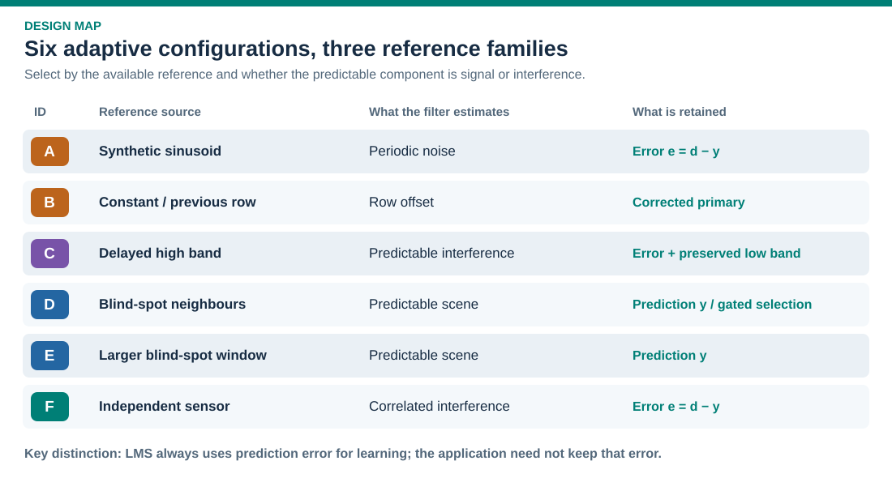

## 1. A common mathematical model

For a primary image sample `d[k]` and a tap vector `x[k]`, compute

$$
y_k=\mathbf w_k^T\mathbf x_k,\qquad e_k=d_k-y_k,\qquad
\mathbf w_{k+1}=\mathbf w_k+\mu_2 e_k\mathbf x_k.
$$

The output **before** the weight update is used for the current sample. A–C and F remove an estimate of unwanted structure (with B and C using additional image-specific processing). D and E instead estimate the wanted signal from neighbours. D gated changes the output and the update condition. If the reference contains scene structure, minimising squared error alone cannot distinguish that structure from noise.

**One numerical LMS step.** Suppose the centred target is 0.30, the regressor is (0.4, −0.2), and the weights are (0.5, 0.1). The prediction is 0.18 and the error is 0.12. With a full LMS step of 0.05, the new weights are (0.5024, 0.0988). A canceller keeps 0.12 at this sample, while a predictor keeps 0.18 (before any mean restoration). This is illustrative arithmetic, not a recommended universal step.

## 2. The six scenarios in images

The following SVGs contain independently computed, deterministic 96 × 64 synthetic examples. Each illustration reports its own parameters. They are generated with a small standalone implementation of the core equations, **not** a rerun of the 512 × 512 camera benchmark or a ranking across scenarios. Different scenarios deliberately use different signals and disturbances. Clean targets are used only for generating the corruption and evaluating the result, not for weight adaptation. F uses an independent simulated dark calibration. The raster display uses 32 gray levels; PSNR is calculated on the original floating-point samples, with the estimate clipped to [0,1].

### A — Synthetic quadrature reference

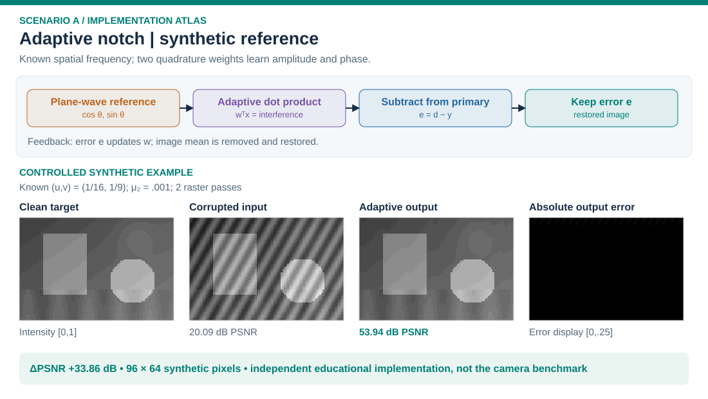

At the known frequency, let the interference be 0.14 cos(θ + 0.7). With unit-amplitude references its exact coefficient pair is (0.14 cos 0.7, −0.14 sin 0.7), approximately (0.1071, −0.0902). LMS learns the pair without a clean target. The demo supplies the true frequency to isolate amplitude/phase adaptation; the original image benchmark detects frequencies from the noisy input. The 1-D notch response assumes a fixed phase increment, while a rasterised 2-D plane wave may have phase discontinuities at row boundaries. The 2-D implementation should therefore be interpreted as adaptive projection onto spatial sinusoids, not as a globally shift-invariant 2-D notch.

**Inspect:** frequency mismatch, scene spectral peaks, the residual at the offending frequency, and coefficient convergence. A genuine periodic texture can be removed by an erroneously selected peak.

### B — Constant reference and interline drift

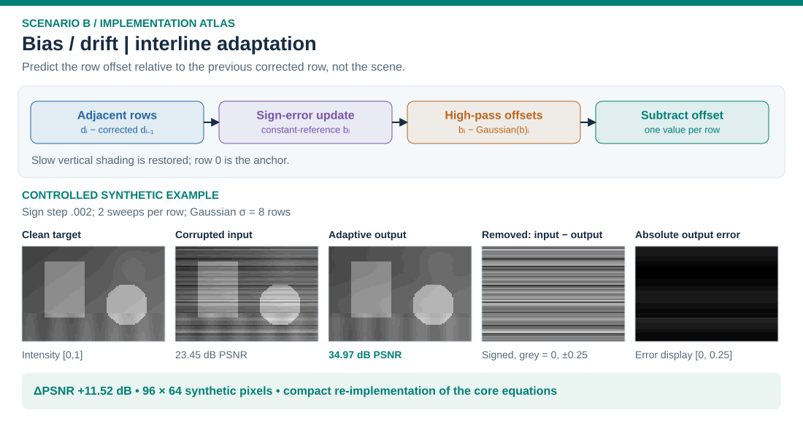

A constant reference has one adaptive coefficient. For the textbook LMS case, with b = 0.10, d = 0.14 and μ₂ = 0.05, the updated offset is 0.102. In the natural-image variant the target is the difference from the previous corrected row. A sign-error update estimates a robust row difference, then Gaussian smoothing of the offset sequence identifies the slow portion to restore. Example: an estimated offset of 0.07 with a slow component of 0.02 implies a correction of 0.05. A scene with real horizontal stripes violates the smooth-background assumption.

**Inspect:** the row-mean profile, slow offset versus fast offset, and cumulative drift from the first-row anchor.

### C — Delayed reference on a protected high band

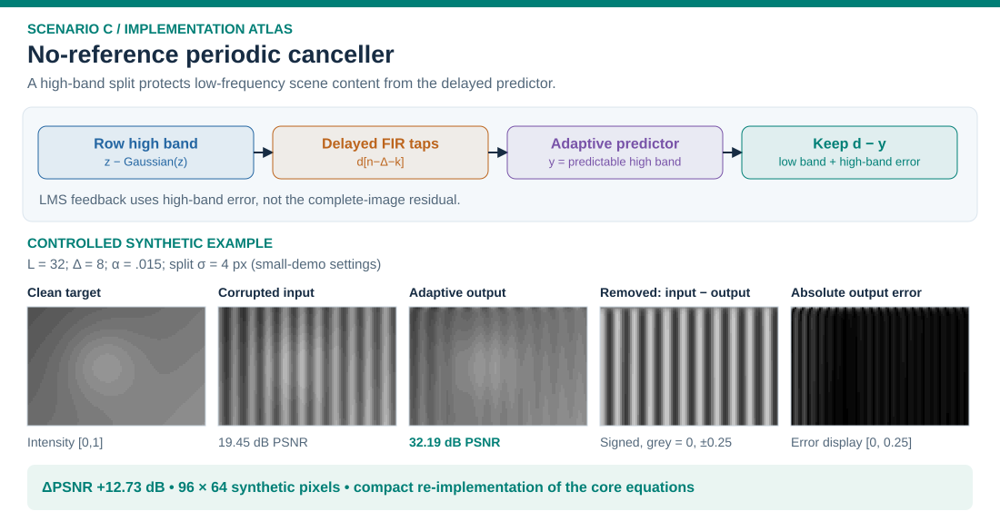

Let the row-centred image be z, its Gaussian low band ℓ, and h = z − ℓ. The delay-line tap vector is built from h, not from the original d. If the learned predictor gives 0.08 at a pixel of value 0.51, its corrected value is 0.43. This subtracts only the prediction; the low band and the row mean are retained by construction. The split does not make all images white: high-frequency scene patterns can remain correlated. The demo uses a shorter FIR and larger step than the repository default to make adaptation observable on a tiny image.

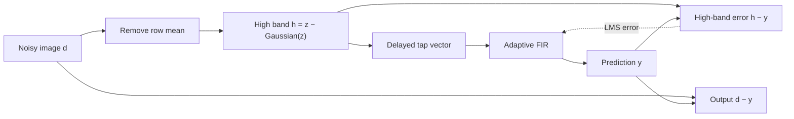

### D — Predict image content; gate impulses

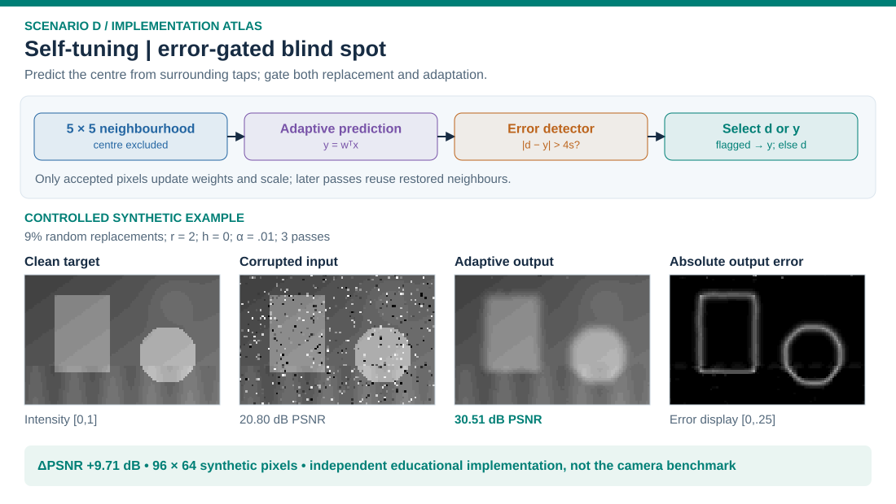

For a 5 × 5 window with a 1 × 1 hole there are 24 taps. Suppose the predicted centre is 0.48, the measured centre is 0.92, and the robust scale is 0.05. The threshold at k = 4 is max(4 × 0.05, 0.1) = 0.20; |0.92 − 0.48| = 0.44 exceeds it, so the prediction replaces the centre and the weight update is skipped. The floor 0.1 takes over where the scale falls below 0.025, on flat and nearly noise-free areas. If d = 0.53, the error is 0.05: keep the measured value and adapt. The code centres the input, maintains a running error scale, and updates the neighbourhood source between passes. It does not use a ground-truth corruption mask.

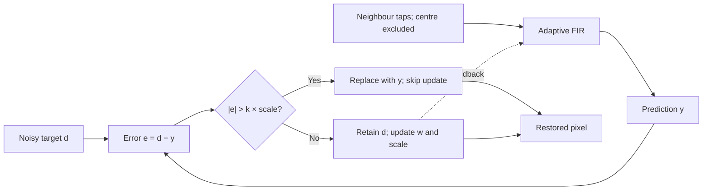

### E — Adaptive line enhancement

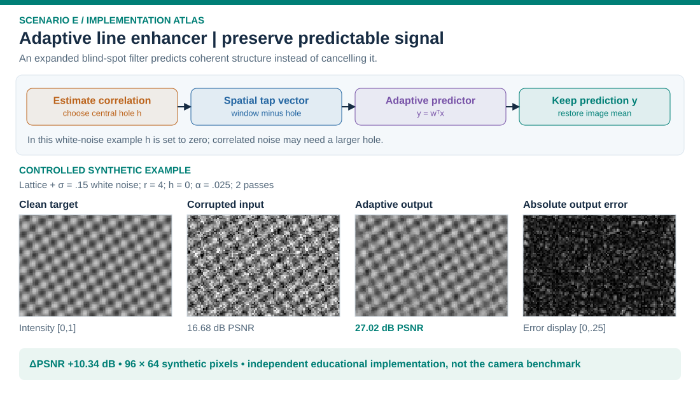

On a non-DC, non-Nyquist DFT-bin sinusoid with white noise and L = 32, SNR = 0.25 (linear), the ideal line amplitude gain is 4/5 = 0.8. The corresponding L = 64 gain is 8/9 ≈ 0.889. Increasing L reduces line attenuation under this model, but increases arithmetic, and slow eigenmodes and excess LMS error can offset the gain. The 2-D analogue uses the surrounding window and estimates noise correlation to select a hole. This example uses a specified zero-radius hole for white noise; the original E implementation can estimate the hole.

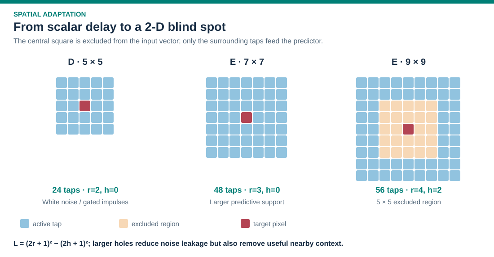

The centre of a 9 × 9 window with h = 2 excludes 25 samples and retains 56. The predictor needs enough correlation in the wanted image at those distances. Reflection at image boundaries and adaptation using the same frame mean that the implementation is a blind-spot regressor, not a strict statistical guarantee of independence for every predicted pixel.

### F — Physical-reference architecture, simulated here

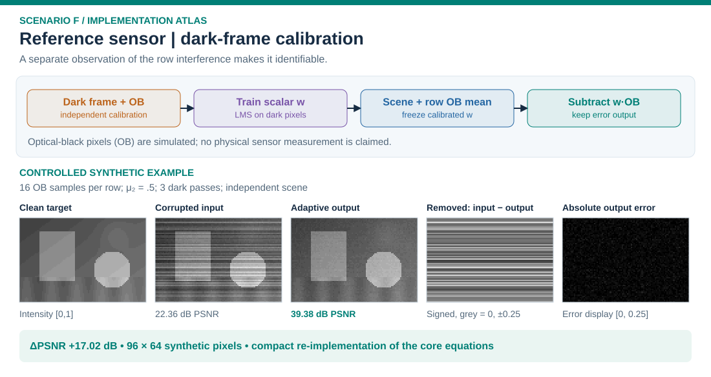

For a row reference x = 0.075 and calibrated coefficient w = 0.96, the correction is 0.072. In the optical-black case one estimate is broadcast along the row. In the reference-output case a synchronised per-pixel reference is filtered in raster order. The dark calibration learns the coefficient without scene content, then the scene correction uses frozen weights. If the independent primary and reference noise ratios are 0.01 and 0.02, respectively, the ideal scalar Wiener model gives a reduction of approximately 15.33 dB. This limit assumes stationarity, accurate alignment and a reference free of scene signal.

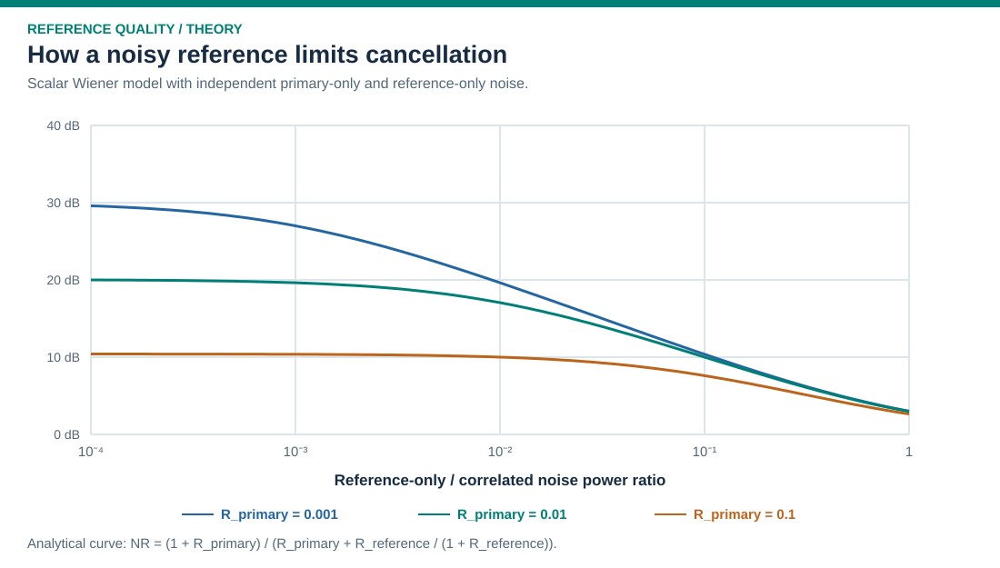

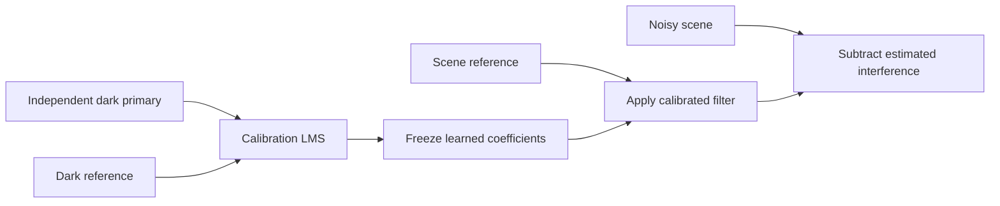

## 3. Interpreting all six together

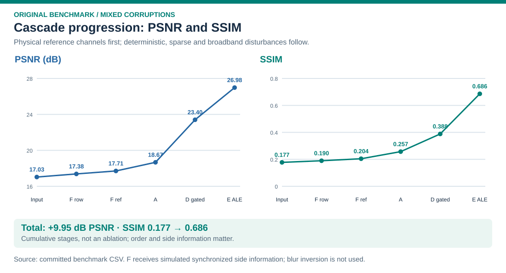

The original combined-noise pipeline uses F twice (optical-black, then readout reference), A, D gated and E. This ordering protects subsequent predictors from strong structured errors before they attempt to reconstruct the scene. B is not included when the superior row reference exists; C is not included when periodic peaks can be detected. This is a fixed cascade, not an exhaustive search over orderings. See the [committed CSV](../results/benchmark_python.csv).

## 4. Reproduce or extend

From the repository root, rebuild this supplemental atlas:

```sh
node tools/build_atlas.cjs
```

Node.js 18 or newer; no external packages. The benchmark-derived charts read the existing CSV; the synthetic figures are computed from deterministic arrays. The separate [synthetic CSV](../results/atlas_synthetic.csv) stores only the six small demonstrations.

For more examples using the **original Python implementations**, use:

```sh
pip install -r requirements.txt
python python/extended_examples.py --image data/camera.png --size 256 --seed 0
```

The optional script writes individual side-by-side clean / noisy / restored / absolute error panels and a CSV to a separate output folder. The input and parameters are recorded. It also accepts a local image and another seed. This script does not overwrite the original benchmark or its figures.
