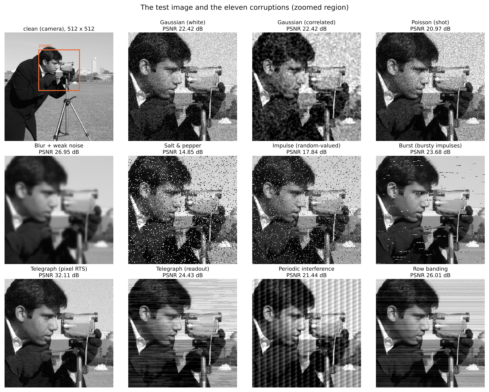
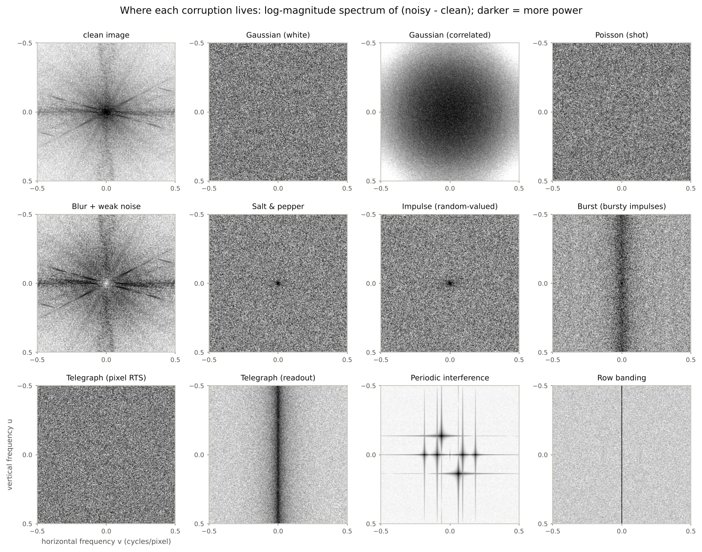
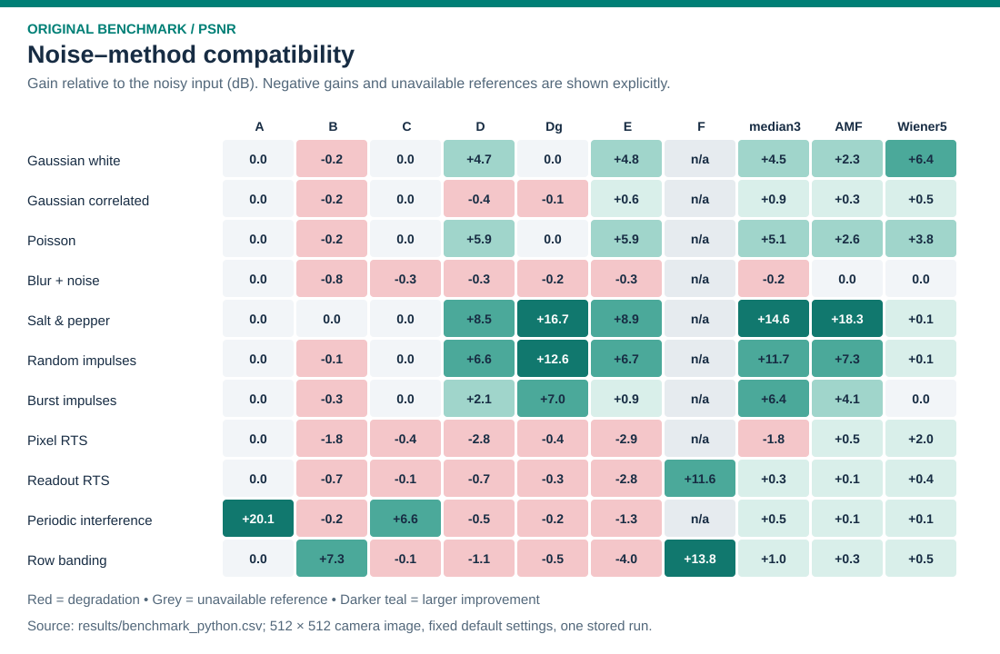

# Noise and interference models

[back to README](../README.md)

All models act on a clean image $x \in [0,1]$ of 512 x 512 pixels and are implemented identically in
`python/adaptive_denoise/noise.py` (`noise.make(key, x)`) and `matlab/make_noisy.m` (`make_noisy(key, x)`).
The raster (readout) order is row by row, left to right; processes that live in readout time are generated
along it. Images are not clipped after corruption; the metrics clip the estimate to [0, 1].

Each model also returns its **side information**: what a real system measures together with the image. That
means the masked-pixel reference and the reference output channel (each with a dark frame), the known PSF, and
the true masks (for evaluation only).

| key | model | parameters | physics | fits |
|---|---|---|---|---|
| `gaussian` | $y = x + n$, $n \sim \mathcal N(0,\sigma^2)$ white | $\sigma$ = 20/255 | thermal and read noise | D, E |
| `correlated` | white noise blurred by a Gaussian, rescaled | $\sigma$ = 20/255, correlation 1 px | demosaicked or resampled noise, analog filtering | E (blind spot sized to the correlation) |
| `poisson` | $y = \mathrm{Poisson}(p\,x)/p$, variance $x/p$ | peak $p$ = 60 photons | photon shot noise | D, E |
| `blur` | Gaussian PSF, then weak white noise | PSF $\sigma$ = 1.6 px, noise 0.005 | defocus, motion, optics | none of the six; see [beyond_blur.md](beyond_blur.md) |
| `salt_pepper` | a fraction of pixels set to 0 or 1 | 10 % | dead or saturated pixels, bit errors | D gated (adaptive median best) |
| `impulse` | a fraction of pixels replaced by U(0, 1) | 10 % | random-valued transmission errors | D gated |
| `burst` | two-state good/bad channel along the raster; in the bad state 90 % of pixels are replaced by U(0, 1) | mean burst 8 px, 3 % of the raster bad | bursty transmission or readout errors | D gated |
| `telegraph_pixel` | 5 % of pixels are random-telegraph-signal pixels caught at $\pm a/2$, $a \sim$ U(0.1, 0.3), plus read noise 0.01 | one frame | pixel RTS (popcorn) noise in the in-pixel transistor | single frame: weak; a frame sequence gives each pixel a temporal reference |
| `telegraph_readout` | two-level offset $\pm$0.06 switching with mean dwell 60 px in readout time, plus read noise 0.01 | reference output: gain 0.8, noise 0.01 | popcorn noise of the shared output amplifier | F (reference output) |
| `periodic` | sum of $A\cos(2\pi(ui+vj)+\phi)$ | stripes 0.10 at $v$ = 0.0925, harmonic 0.04 at 0.185, moire 0.06 at $(u,v)$ = (0.137, 0.061) | electrical pickup, flicker, vibration, moire | A; C without a frequency |
| `banding` | one offset per row, $c_i \sim \mathcal N(0, 0.05^2)$, plus read noise 0.01 | 16 optical-black columns | shared row circuitry | F (optical-black reference); B without one |

Random telegraph (often called popcorn) noise is discrete switching. Burst errors can be generated by a related two-state model but describe clustered corruption rather than necessarily the same physical noise mechanism. Here **telegraph** covers the
switching itself (per pixel, or in the output amplifier), and **burst** covers clustered impulsive errors along
the readout.

## Where each corruption lives in frequency

The 2-D spectrum of the corruption alone (noisy minus clean) predicts which scenario can help:

* **flat** (white Gaussian, Poisson, impulses, pixel RTS): no structure to cancel. Only a predictor that
  exploits the image (D, E) or a robust detector (D gated) helps.
* **a blob around DC** (correlated noise): the noise overlaps the image's own spectrum. A larger blind spot
  helps, but only partly.
* **points** (periodic): each point is a sinusoid, cancelled by a notch (A) or found by a predictor (C).
* **a line along $v = 0$** (row banding): constant along rows and white across them. It is cancelled by a
  per-row reference (F), or estimated line to line (B).
* **a band around $v = 0$** (readout telegraph): slow switching along the row, white across rows, and
  indistinguishable from image structure without a reference (F).
* **blur** removes high frequencies instead of adding anything; no canceller restores them.

## The all-noise mixture

`noise.mixed(x)` / `make_mixed(x)` applies everything in physical order at reduced strength. The order is: blur
0.8 px, shot noise at peak 200, 2 % pixel RTS, banding 0.04 and readout telegraph 0.04 (with their references
and a dark frame), periodic interference at 70 %, read noise 0.02, then bursts, 1 % impulses and 2 % salt and
pepper. The input PSNR is 17.03 dB. The scenarios chained in [the README](../README.md#all-corruptions-at-once)
raise it to 26.98 dB.

## Visual compatibility map

The gains are taken directly from the committed Python CSV; they are not universal rankings. All side channels and dark frames described here are generated by the noise simulator. See [evaluation protocol](evaluation_protocol.md) for the information assumptions and the distinction between the original benchmark and supplemental synthetic examples.
