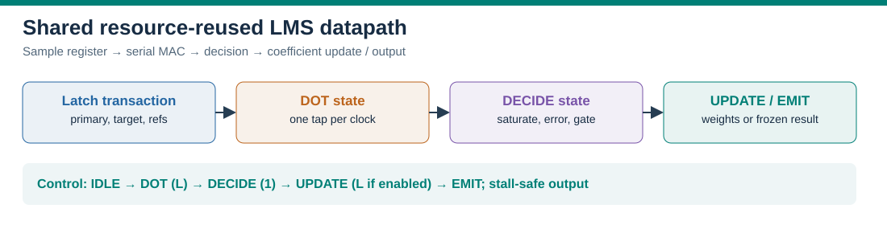

# Fixed-point Verilog adaptive image-filtering architecture

[Project overview](../README.md) · [Software implementation atlas](../docs/implementation_atlas.md) · [Integration](docs/integration.md) · [Verification](docs/verification.md)

This hardware layer implements the six adaptive configurations as synthesizable, vendor-neutral Verilog-2005 processing cores. It is deliberately a **transaction-level fixed-point RTL architecture**, not a claim of completed FPGA placement, sensor integration or software bit equivalence. A common serial LMS engine serves A, C, D, E and F; B uses a dedicated constant-reference sign-error estimator. The original Python/MATLAB experiments remain unchanged.



## 1. Architecture inventory

| Scenario | RTL top | Default taps / state | Output | Image-specific front end |
|---|---|---:|---|---|
| [A — notch](docs/A_notch.md) | [scenario_a_notch.v](rtl/scenario_a_notch.v) | 2 per frequency | residual | spatial phase accumulator + quadrature LUT |
| [B — drift](docs/B_bias.md) | [scenario_b_bias.v](rtl/scenario_b_bias.v) | 1 bias | corrected row | estimate/replay, previous row and slow-offset buffer |
| [C — reference-free](docs/C_periodic.md) | [scenario_c_periodic.v](rtl/scenario_c_periodic.v) | 128 taps, delay 8 | raw minus high-band prediction | row Gaussian high-band FIR + internal delay line |
| [D — self-tuning](docs/D_self_tuning.md) | [scenario_d_self_tuning.v](rtl/scenario_d_self_tuning.v) | 24 taps, 5 × 5 | predicted or gated | window stream, centre mask, optional robust threshold |
| [E — enhancer](docs/E_line_enhancer.md) | [scenario_e_line_enhancer.v](rtl/scenario_e_line_enhancer.v) | 48 taps, 7 × 7 (configurable hole) | predicted image | window stream + compile-time hole |
| [F — reference](docs/F_reference.md) | [scenario_f_reference.v](rtl/scenario_f_reference.v) | 1 default | residual | optical-black mean or aligned reference taps |

## 2. Arithmetic and scheduling

Let signed integer code X represent X / 2^F, with W=16 and F=12 by default. The representable interval is [−8, 7.999755859375]. Inputs, coefficients, predictions and outputs saturate to W bits where indicated; the signed error is W+1 bits. Inputs must already fit the signed format; external quantisation must clip before packing.

For a vector of L codes x and weights w:

```text
acc  = sum(w[k] * x[k])                 # signed 64-bit accumulation at 2F
pred = sat_W(acc >>> F)                # floor toward -infinity
err  = target - pred                   # exact signed W+1
dw[k]= (err * x[k]) >>> (F + MU_SHIFT) # mu = 2^(-MU_SHIFT)
w[k] = sat_W(w[k] + dw[k])
```

There is **no implicit per-sample normalisation** or floating-point operation. The power-of-two step is a design parameter; software's variance-normalised step can be approximated by a suitably chosen shift after calibration. Arithmetic shift gives a small negative rounding bias; the reference model deliberately reproduces it. For tested W=16, L≤128 the accumulator has ample headroom. Supported parameter assumptions: 8≤W≤24, 1≤FRAC<W-1, TAPS≥1, nonnegative MU_SHIFT with FRAC+MU_SHIFT<63, and 0≤H<R for spatial windows. For B require MU_SHIFT≤FRAC. For nondefault dimensions verify accumulator bounds; the accumulator is not itself saturating.

The shared [lms_serial](rtl/lms_serial.v) traverses taps twice: a dot-product phase, a decision phase, and (when enabled) a coefficient-update phase. It preserves the exact sequential weight dependency between pixels. Its arithmetic uses one dot-product multiplier expression and one gradient multiplier expression, not L parallel multipliers. Actual resource mapping is synthesis-tool dependent. A transaction is accepted only when idle; all regressors and metadata are latched. The result is valid after L+1 cycles without adaptation, or 2L+1 with adaptation. With ready continuously high, acceptance-to-acceptance intervals are L+3 and 2L+3 cycles respectively. B uses a one-entry elastic register and can accept consecutive samples with no downstream stall.

The serial architecture deliberately favours resource reuse over high pixel throughput. Illustrative theoretical throughput at 100 MHz (not measured or a timing claim):

| Core | L | Adapted II | Ideal MSamples/s |
|---|---:|---:|---:|
| A (one harmonic) | 2 | 7 | 14.29 |
| B | scalar | 1 | 100 |
| C | 128 | 259 | 0.386 |
| D | 24 | 51 | 1.96 |
| E | 48 | 99 | 1.01 |
| F | 1 | 5 | 20.0 |

The table excludes front-end latency, stalls, frame passes and memory transfer. For frozen F, II is 4 cycles at L=1. A 512 × 512 frame at 30 FPS needs 7.86 MSamples/s before multiple passes; the serial C/D/E configurations would not meet that example rate at 100 MHz. To scale up, use P MAC lanes, coefficient banking, a pipelined reduction tree and carefully scheduled updates. Independent image tiles with independent coefficient banks change the adaptation policy; do not claim sample-exact equivalence without verification.

## 3. Supplementary hardware

- [phase_raster](rtl/phase_raster.v) and [quadrature_lut_q12](rtl/quadrature_lut_q12.v): coarse sinusoidal references; the phase accumulator carries the row and column increments.
- [gaussian_highband_q12](rtl/gaussian_highband_q12.v): 33-tap, symmetric sigma=4 Gaussian approximation with exactly unity DC coefficient sum. Input window is supplied by an aligned row-buffer controller.
- [window_stream_valid](rtl/window_stream_valid.v): parameterised raster-to-square-window front end with line stores, centre coordinates and backpressure. Produces interior windows only.
- [window_taps](rtl/window_taps.v): elaboration-time tap extraction, including larger holes.
- [robust_threshold](rtl/robust_threshold.v): shift-based approximation of the gated robust-scale controller.
- [ob_mean_pow2](rtl/ob_mean_pow2.v): power-of-two optical-black reference mean.

## 4. Smoke test and generic synthesis

From repository root, on Ubuntu:

```bash
sudo apt-get update
sudo apt-get install -y iverilog yosys
python3 hardware/model/fixed_model.py
bash hardware/run_smoke.sh
bash hardware/run_synth.sh
```

Run only scenario C with `bash hardware/run_smoke.sh c`. The runner compiles all RTL sources and the selected testbench with Icarus Verilog, fails on any mismatch, and removes temporary simulator outputs. The generic synthesis runner elaborates all six default tops, converts processes, optimises and structurally checks the netlists. It does not place or route for a specific FPGA.

[Golden vector format](vectors/README.md) · [Reference-model smoke record](results/reference_smoke.json) · [Verification details](docs/verification.md)

**Evidence status:** all six integer-reference stimulus streams (938 transactions) and their scenario-specific convergence assertions were executed when this hardware layer was created. The HDL simulation and Yosys checks are separately runnable; see the GitHub Actions results for actual RTL execution status. No FPGA timing, area, power, board measurements or camera PSNR are claimed by this hardware layer.
