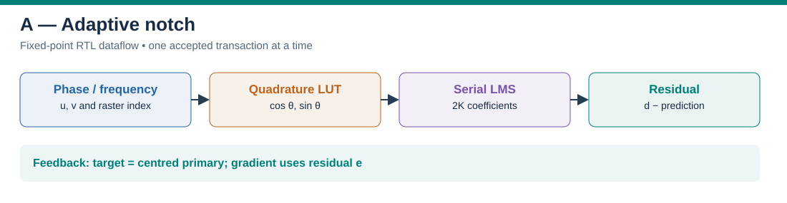

# A — Adaptive notch

[Hardware overview](../README.md) · [RTL](../rtl/scenario_a_notch.v) · [Testbench](../tb/tb_a.v) · [Golden vectors](../vectors/a.txt)

## Operation

For K selected spectral peaks, the input vector is [cos θ₀, sin θ₀, …]. The core computes the noise estimate with 2K signed coefficients, then subtracts it from the centred primary. The output is not the prediction. The spatial phase helper uses modulo-2^P increments for vertical and horizontal frequency; assert frame_start on the first pixel and row_start on the first pixel of each later row. The top four bits feed the 16-entry Q12 LUT. A larger LUT or CORDIC can improve frequency/phase accuracy. Each phase must advance only when its associated pixel transaction is accepted. Frequency detection and image mean computation/restoration remain host/frontend functions.

**Example:** with refs (4096, 0) and coefficient 1536, the dot product yields 1536; primary 2048 returns residual 512. The smoke trains both quadratures with positive and negative samples, then disables adaptation and checks recovery of an added scene offset. The test uses one harmonic; multi-harmonic configuration requires further validation.

## Interface

All ports use a rising-edge ready/valid handshake, synchronous active-high reset and signed fixed-point code format from the [hardware specification](../README.md). Hold inputs until accepted, and preserve output order. All scenario-specific flags and reference samples must correspond to the same primary transaction. See [integration](integration.md) for scheduling and frame boundaries.
