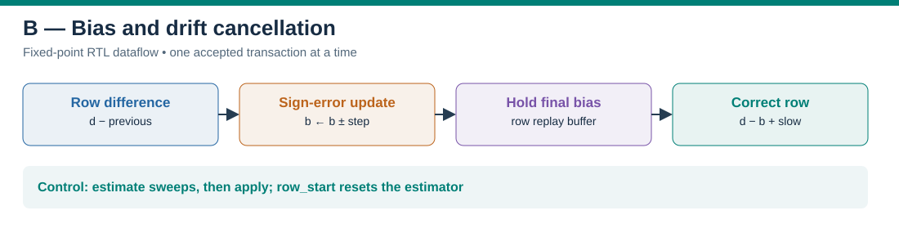

# B — Bias and drift cancellation

[Hardware overview](../README.md) · [RTL](../rtl/scenario_b_bias.v) · [Testbench](../tb/tb_b.v) · [Golden vectors](../vectors/b.txt)

## Operation

The dedicated scalar engine receives the current pixel and the corresponding previous corrected row pixel. In estimate mode it subtracts the current bias from their difference, adjusts the bias by ±2^(−MU_SHIFT), and returns the post-update bias. Zero error makes no change. Set in_row_start on the **first estimate transaction**, not on replay or subsequent sweeps. Once the row is estimated, replay its original pixels with in_estimate=0 and use the held bias. For natural-image processing keep a preliminary corrected previous row for the next estimate. Store per-row estimates, compute the slow Gaussian offset sequence across rows and add it during final correction. External row/frame buffering is required; the top provides scalar estimate and apply operations, not a complete frame scheduler. The textbook scalar high-pass using ordinary LMS is a separate software configuration; this top implements the robust interline sign variant. Row 0 should bypass correction as the anchor.

**Example:** row difference 512 codes, step 64 codes: eight nonzero sign updates reach 512. Applying a slow offset 128 to primary 2560 returns 2176. The smoke includes negative drift, zero-error hold and estimate/replay sequencing.

## Interface

All ports use a rising-edge ready/valid handshake, synchronous active-high reset and signed fixed-point code format from the [hardware specification](../README.md). Hold inputs until accepted, and preserve output order. All scenario-specific flags and reference samples must correspond to the same primary transaction. See [integration](integration.md) for scheduling and frame boundaries.
