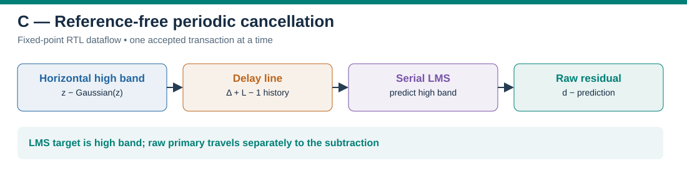

# C — Reference-free periodic cancellation

[Hardware overview](../README.md) · [RTL](../rtl/scenario_c_periodic.v) · [Testbench](../tb/tb_c.v) · [Golden vectors](../vectors/c.txt)

## Operation

Supply aligned raw primary and high-band samples. The optional 33-tap Gaussian FIR has sigma=4, radius 16 and fixed coefficients summing to 4096. For an interior sample the Gaussian rejects DC in the high-band path; the software uses row demeaning and reflected boundaries. Supply external row-window alignment and boundary policy if matching the software. The RTL maintains Δ+L−1 history samples of the high band and packs taps h[n−Δ−k]. History shifts only on in_valid && in_ready. Set in_row_start with the first transaction of each row. The first Δ+L−1 samples pass through unchanged; unlike software reflection, no prediction or update occurs until history is full. Weights persist between rows. The update error is h−prediction, but the output is raw d−prediction.

**Example:** with raw d=3548, high-band prediction 2048, the desired output is 1500. The smoke uses Δ=2, L=4, a periodic sequence, two row boundaries and checks cancellation after convergence. Default L=128 requires longer rows/training.

## Interface

All ports use a rising-edge ready/valid handshake, synchronous active-high reset and signed fixed-point code format from the [hardware specification](../README.md). Hold inputs until accepted, and preserve output order. All scenario-specific flags and reference samples must correspond to the same primary transaction. See [integration](integration.md) for scheduling and frame boundaries.
