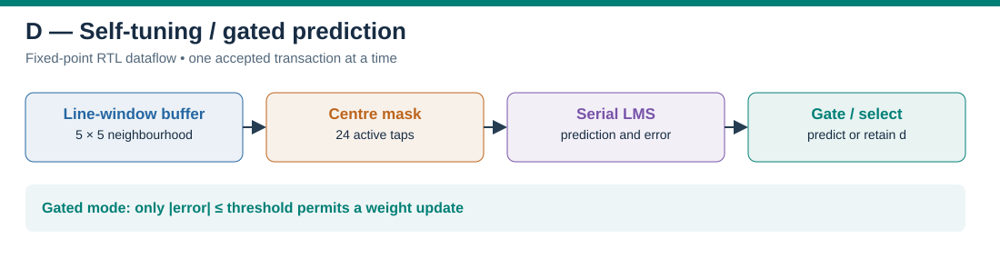

# D — Self-tuning / gated prediction

[Hardware overview](../README.md) · [RTL](../rtl/scenario_d_self_tuning.v) · [Testbench](../tb/tb_d.v) · [Golden vectors](../vectors/d.txt)

## Operation

The input is a centred target and packed full (2R+1)² neighbourhood. The centre is excluded regardless of its supplied value. For ordinary D keep the prediction (in_gate=0). For gated D set in_gate=1 and supply an unsigned Q12 threshold. When abs(error)>threshold return the predicted centre and skip coefficient adaptation; otherwise retain the primary and adapt if enabled. Initialise to approximately uniform weights for Dg (INIT_WEIGHT=floor(4096/24)=170); ordinary D defaults to zero. For multiple passes, re-buffer the previous output as the neighbourhood source while maintaining the original target externally. Add the image mean or median back externally.

The optional robust_threshold helper implements scale += (1.5*abs(error)−scale)/128 rather than the software's 1.4826 and 0.01 constants. Connect update_clean to out_valid && out_ready && !out_flag for a gated, adaptation-enabled stream; keep control metadata aligned. It updates only after a result handshake. For a fixed threshold, do not instantiate it.

**Example:** threshold=300, primary=2500, predicted=510: the error is 1990, so replace with 510 and freeze weights for this sample. The smoke exercises ordinary and gated modes, both error signs, poisoned centre entries and subsequent valid samples.

## Interface

All ports use a rising-edge ready/valid handshake, synchronous active-high reset and signed fixed-point code format from the [hardware specification](../README.md). Hold inputs until accepted, and preserve output order. All scenario-specific flags and reference samples must correspond to the same primary transaction. See [integration](integration.md) for scheduling and frame boundaries.
