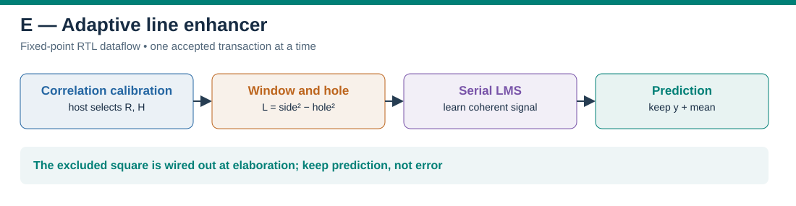

# E — Adaptive line enhancer

[Hardware overview](../README.md) · [RTL](../rtl/scenario_e_line_enhancer.v) · [Testbench](../tb/tb_e.v) · [Golden vectors](../vectors/e.txt)

## Operation

This architecture reuses the spatial predictor and selects a compile-time hole radius H (0≤H<R). Active count L=(2R+1)²−(2H+1)². A 7×7 window with H=0 has 48 taps; a 9×9 with H=2 has 56 taps. A host estimates noise autocorrelation and chooses the hardware configuration. Run-time hole reconfiguration, multiple passes, mean restoration and padding are not part of the core. The included streaming window module produces valid interior centres with row and column tags; it does not reflect borders.

**Example:** a 9×9 lattice window with 25 excluded centre-region values and 56 active taps is used for the smoke. Extreme signed values are deliberately inserted in the excluded region. The expected predictions converge to ±768 independently of those poisoned values.

## Interface

All ports use a rising-edge ready/valid handshake, synchronous active-high reset and signed fixed-point code format from the [hardware specification](../README.md). Hold inputs until accepted, and preserve output order. All scenario-specific flags and reference samples must correspond to the same primary transaction. See [integration](integration.md) for scheduling and frame boundaries.
