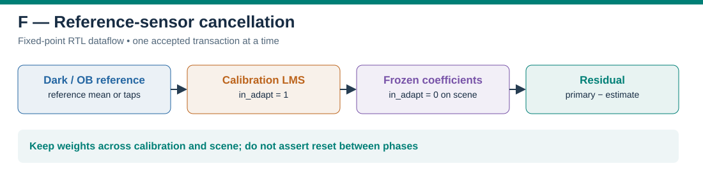

# F — Reference-sensor cancellation

[Hardware overview](../README.md) · [RTL](../rtl/scenario_f_reference.v) · [Testbench](../tb/tb_f.v) · [Golden vectors](../vectors/f.txt)

## Operation

Use TAPS=1 with the optical-black mean (the included helper averages 16 signed values by default). Supply the same row mean for every pixel of that row. For readout-reference cancellation use an aligned current/reference history vector; TAPS can be larger for an unknown FIR channel. Train on independent dark primary and dark reference samples with adaptation enabled. Switch to scene samples with in_adapt=0, without resetting coefficients. Frozen coefficients reject reference-correlated interference without updating from scene energy. Synchronized acquisition, reference delay alignment and gain calibration are system responsibilities.

**Example:** primary=3584, predicted reference contribution=1521: output=2063, close to the clean 2048 code. The smoke learns a signed reference-to-primary gain using dark samples, freezes it for a scene offset, and checks positive/negative output saturation. The multi-tap physical channel and sensor hardware are not measured by this test.

## Interface

All ports use a rising-edge ready/valid handshake, synchronous active-high reset and signed fixed-point code format from the [hardware specification](../README.md). Hold inputs until accepted, and preserve output order. All scenario-specific flags and reference samples must correspond to the same primary transaction. See [integration](integration.md) for scheduling and frame boundaries.
